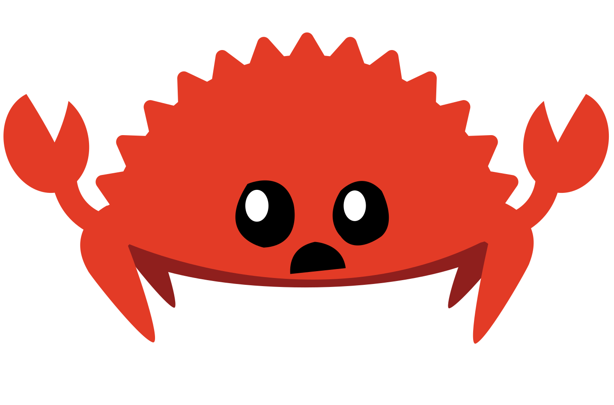
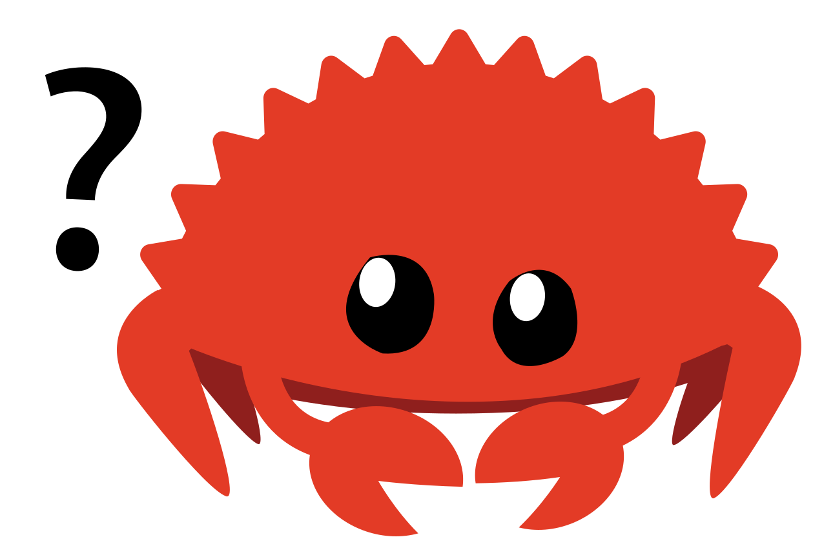
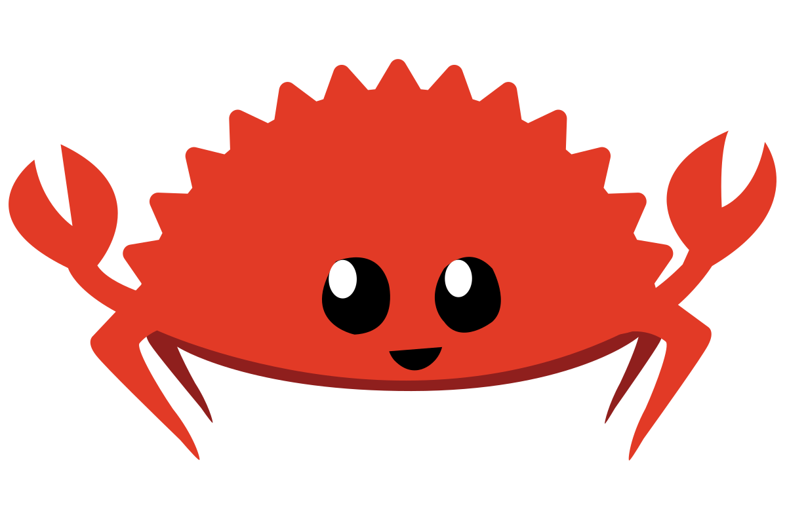

  
  
  

# Learning Rust

A professional learning record of Rust - which will evolve into applications focused on practicing physics, algorithms, game development, socket programming, and beyond - in Rust.

## Goals (Dynamic)

- Learn Rust fundamentals
- Create subprojects for post-degree practice
  - Physics (with Bevy)
  - Algorithms
  - Game Development (with Bevy)
  - Socket Programming (NetSec + Multiplayer Games)
  - Professional Projects
  - Review all course material from degree (and work it in where possible)
- For this git to be my personal reference and career demonstration

> [!TIP]
> Productivity Tip: Kill many birds with 1 stone
>   ( learn rust + practice compSci + market myself + prep for Bevy )

## Hello, World!

My name is Zach, I'm based in Vancouver, British Columbia, Canada, and hold a Bachelor of Science in Applied Computer Science (Game Development) from BCIT.

> [!NOTE]
> Completed 4/5 courses from Network Security Applications set also. 💪
>   Built C2 botnet as major project for that set. 🤖🕸️

### Repository Purpose

I didn't market myself much throughout my schooling. I used several git accounts, used perforce for games courses, my major projects are top secret (shh..). Frankly I don't like dumping on git my instructors resources or old assignment solutions after-the-fact.

And so that's where this Rust venture comes in! Since Rust has some incredible strengths as a programming language (and novel mechanisms to learn), it's a great way to review and recreate some of my favorite projects, pursue some more ambitious objectives, and market myself in a more thoughtful way going forward.

Rust is a fascinating language conceptually with excellent characteristics for my primary hobbies and professional goals - and so this monotonous process of self-marketing becomes something rather exciting instead. So it is in that spirit of practice, marketing, and intellectual exploration - that I begin this adventure.

Advantages of Rust:

- Compiles into machine code
- High performance
  - C/C++ level performance with stronger memory and concurrency safety.
- Safer conduct
  - Memory safety without garbage collection
  - Pushes several run-time errors into the compile time checks
    - e.g. use-after-free, null-pointer dereferences, double frees, (many) buffer overflows
  - Ownership and borrowing
  - Thread safety

Those advantages are excellent for:

- System Programming
- Games (Bevy)
- Socket programming
- backend programming
- Web Assembly
- Embedded Programming

Some disadvantages:

- Steeper learning curve (not too bad actually!)
- Longer compile time (maybe in some production environments!)

In short, it offers:

- C/C++-level performance with strong memory and concurrency safety.
- And a plethora of practical use-cases for my interests

<table cellpadding="0" cellspacing="0"  bgcolor="#090909"   border="1"
  frame="box"   rules="none">
  <tr>
    <td width="66" valign="middle">
      
    </td>
    <td>
   <strong>Rustacean in training 
</strong>
    </td>
  </tr>
</table>

## Project Orchestration (Flexible)

I enjoy the flexible orchestration that solo projects award. I often advocated for individual projects during my degree, whenever possible, for the benefit of creative autonomy without bureaucracy, as well as experience of working on each inch of a project rather than a subset. As a consequence - I take full ownership of my work more naturally.

Like with Agile methodology: having a plan matters, but so does listening to signals and pivoting to high value targets (Dijkstra). Weighing new ideas, making trade-offs, solving unexpected problems - is the humanity in software development. Flexibility and creativity foster "Eureka!" moments that were a particular highlights in some of my academic projects. A compass, a map, and binoculars together - maketh an adventurer. 

### Plan

I'll maintain this project whenever I'm not employed or otherwise working on a private project implementation. I will try and do at least 1 meaningful commit per day otherwise.

My projects steps are laid out below. You can consider the pending ones as flexible nodes I'm interested in pursuing - a list percolated out of the backlog from the ReadMe_Brainstorm document.

This repository is a large catch all for a bunch of things that I'm willing to share - stuff in different states of progress. This is not about producing an outcome like in most repositories git. It's an educational learning resource I can publicize, and so inherently broad, amorphous, experimental. However, I will try and formalize some sections like demos, and some notes.

### Resource Links

I'll be updating these resources for my reference as I go.

- [Rust Learning Links](./notebooks/00-rust-learing-links.md) (Noted as encountered)
- [TimeSchedule](./schedule/pomodoros-timesheet.ods) (Pomodoros based)
<!-- - [Rust - Brainstorm](./README_BRAINSTORM.md) - Rough ideas list for this project -->

---

---

### Step 1 - The Rust Programming Language - Book Read Through

<table cellpadding="0" cellspacing="0"  bgcolor="#2d961f" color="#333"  border="1"
  frame="box"   rules="none">
  <tr>
    <td width="66"  valign="middle"  cellpadding="0"
  cellspacing="0">
      
    </td>
    <td>
    
    <strong>
  Done
<!--  
Still cleaning/refining retroactively alongside next steps -->
</strong>

    </td>
  </tr>
</table>

<!-- 
  -->

My initial objective was to read through the ["The Rust Programming Language"](https://doc.rust-lang.org/book/title-page.html) book and complete all the primary exercises to become familiar with the language and it's core novel mechanisms that have given Rust it's reputation for safety and performance.

#### Read-through/Cheat-Sheet Strategy

My implementation has been to read the (sub)chapters, making notes, and I also added more where I had extra questions, wanted more samples, or ran tangential experiments.

While doing Rustlings (next step), completed the super-summaries aka mostly code-only sections, added links, comments, summaries. (The super summaries are the value added part)

#### Cheat sheets for the 21 chapters:

**Super Summary** sections for quick reference that are mostly just the final code with appropriate concise annotations (and stuff i wanted to reinforce) - as concise as possible. If you have professional coding experience - might be a faster way to explore Rust (skim it's syntax and nuances - like safety enforcement). At any rate - it's a record of my learning progress, and resource reference.

> [NOTE]
> This is about me learning (covering the material twice and summarizing), an exercise in memory retention for me - not publishing for others benefit, so i draw the line at pedanticism. 

> [IMPORTANT]
> Super Summaries for most chapters are within the sub-chapter links "This chapter contains:" section, as I split out concerns in the directory.

1. [Cheat Sheet - ch01 - Getting Started](./tutorial/Rust%20Prog%20Lang/ch01/ch01-cheat_sheet.md)
2. [Cheat Sheet - ch02 - Programming a Guessing Game](./tutorial/Rust%20Prog%20Lang/ch02/ch02-cheat_sheet.md) <!-- - DONE - but fix writing later. -->
3. [Cheat Sheet - ch03 - Common Programming Concepts](./tutorial/Rust%20Prog%20Lang/ch03/ch03-cheat_sheet.md) <!-- - DONE -->
4. [Cheat Sheet - ch04 - Understanding Ownership](./tutorial/Rust%20Prog%20Lang/ch04/ch04-cheat_sheet.md) <!-- - Done -->
5. [Cheat Sheet - ch05 - Using Structs to Structure Related Data](./tutorial/Rust%20Prog%20Lang/ch05/ch05-cheat_sheet.md) <!-- - DONE -->
6. [Cheat Sheet - ch06 - Enums and Pattern Matching](./tutorial/Rust%20Prog%20Lang/ch06/ch06-cheat_sheet.md) <!-- - Done -->
7. [Cheat Sheet - ch07 - Packages, Crates, and Modules](./tutorial/Rust%20Prog%20Lang/ch07/ch07-cheat_sheet) <!-- - Needs special attention -->
8. [Cheat Sheet - ch08 - Common Collections](./tutorial/Rust%20Prog%20Lang/ch08/ch08-cheat_sheet.md) <!-- - Done -->
9. [Cheat Sheet - ch09 - Error Handling](./tutorial/Rust%20Prog%20Lang/ch09/ch9-cheat_sheet.md) <!-- - DONE -->
10. [Cheat Sheet - ch10 - Generic Types, Traits, and Lifelines](./tutorial/Rust%20Prog%20Lang/ch10/ch10-cheat_sheet.md)
11. [Cheat Sheet - ch11 - Writing Tests](./tutorial/Rust%20Prog%20Lang/ch11/ch11-cheat-sheet.md) <!-- - DONE -->
12. [Cheat Sheet - ch12 - An I/O Project: Command Line Program](./tutorial/Rust%20Prog%20Lang/ch12/ch12-cheat_sheet.md)
13. [Cheat Sheet - ch13 - Functional Language Features: Iterators and Closures](./tutorial/Rust%20Prog%20Lang/ch13/ch13-cheat_sheet.md) <!-- - DONE - but fix writing later revie -->
14. [Cheat Sheet - ch14 - More About Cargo and Crates.io](./tutorial/Rust%20Prog%20Lang/ch14/ch14-cheat_sheet.md) <!-- - Done, but needs more work for final cheat-sheet -->
15. [Cheat Sheet - ch15 - Smart Pointers](./tutorial/Rust%20Prog%20Lang/ch15/ch15-cheat_sheet.md) <!-- - Done, but worth a re-read for sure (particularly RefCell) -->
16. [Cheat Sheet - ch16 - Fearless Concurrency](./tutorial/Rust%20Prog%20Lang/ch16/ch16-cheat_sheet.md) <!-- - Done -->
17. [Cheat Sheet - ch17 - Fundamentals of Asynchronous Programming](./tutorial/Rust%20Prog%20Lang/ch17/ch17-cheat_sheet.md) <!-- - Done (worth re-read) -->
18. [Cheat Sheet - ch18 - Object Oriented Programming Features](./tutorial/Rust%20Prog%20Lang/ch18/ch18-cheat_sheet.md) <!-- - Done (worth re-read) -->
19. [Cheat Sheet - ch19 - Patterns and Matching](./tutorial/Rust%20Prog%20Lang/ch19/ch19-cheat_sheet.md) <!-- - Done -->
20. [Cheat Sheet - ch20 - Advanced Features](./tutorial/Rust%20Prog%20Lang/ch20/ch20-cheat_sheet.md)
21. [Cheat Sheet - ch21 - Final Project: Building a Multithreaded Web Server](./tutorial/Rust%20Prog%20Lang/ch21/ch21-cheat_sheet.md)

<!-- #### Final Checklist for all chapters
- [ ] Check - CODE EXAMPLES (add more if wanting)
- [ ] Check - Writing makes sense (each section with a header - has a summary that equates to understanding in the code or other section of 'super summary)
- [ ] Check - Formatting
- [ ] Check - Create links for 'by subject'
- [ ] Check - Added section to my primary advantages guide (if worthy)
- [ ] Check - That all summaries are added to the cheat sheet main
- [ ] Check - Super Summary added to each chapter.
- [ ] Check - Should move definitions in sub-chapter to chapter main page.

- [ ] Do a special interest sheet.
  - Collect the borrowing rules (ch04)
  - Basically 1 paragraph of each sub-chapter (no code)
    - To add to the Super Summary section. -->

<!-- 
 -->

#### UPDATE: FINISHED

---
---

### Side Quest: Rustlings - Exercises/Quizzes

<table cellpadding="0" cellspacing="0"  bgcolor="#2d961f"   border="1"
  frame="box"   rules="none">
  <tr>
    <td width="66"  valign="middle"  cellpadding="0"
  cellspacing="0">
      
    </td>
    <td>
    
    <strong>
  Done
</strong>

    </td>
  </tr>
</table>

<!-- 

<strong>Rustlings - Details</strong>
 -->

<!-- 

<strong>Details</strong>
 -->

To reinforce the book's learning outcomes while fresh in mind - I'd committed to some further practicing of the basics - drawing from the book (while I also refined the cheat sheets further).

Rustlings is an interactive program that has 94 exercises where you have to fix the code to beat the lesson. It's intended as a work book alongside reading the official Rust book, but I wasn't aware of it at first. Doing tests after completing the entire book is better for practicing memory recall anyway.

<!-- 🦀 (Used my cheat sheets or official API reference only) 🦀 -->

The official website for Rustlings is here:

- [Official Rustlings Page](https://rustlings.rust-lang.org/)
- [Rustlings Git](https://github.com/rust-lang/rustlings)

#### UPDATE: FINISHED

<!-- 
 -->

---

---

### Step 2 - Network Security Applications Review/Assignments in Rust

<table cellpadding="0" cellspacing="0"  bgcolor="#e9a700"   border="1"
  frame="box"   rules="none">
  <tr>
    <td width="66"  valign="middle"  cellpadding="0"
  cellspacing="0" bgcolor="#111" >
      
    </td>
    <td>
        
    <strong>
  Currently in progress
</strong>

    </td>
  </tr>
</table>

Ok - so I'm choosing this as next step for a few reasons:

1. Socket programming (NetSec) incorporates low-level programming practices that makes good use of advance techniques around concurrency and parallelism (key strengths in Rust).

- In fact, when i did these courses (which were entirely on Unix based systems), our sample code was always in C (for performance, low-level control, and learning un-abstracted fundamentals). Rust is a direct competitor to C for system level programming, therefore a good place to start and really test the core potential of Rust.

2. I have a personal private hobby project which includes socket programming (I'll discuss more in the ReadMe for this project) - so this is a pre-req.
3. These skills and API language familiarizes would be helpful also to running and planning my multiplayer game backends, exploring embedded programming with my ESP01 and Raspberry Pi, Bluetooth hacking, and so on. It has widest associations.

This leg of the project will constitute me reviewing and super-summarizing all the documentation from my Network Security Applications courses briefly, identifying potential applications and demos in Rust, and then completing/devising a variety of  examples - in Rust! Then - I'll do a large project finally (probably).

I have created the project entry point ReadMe here:

- [NetSec Review Project](./projects/NetSec-Review/NetSec-Review_ReadMe.md)

And so... project commenceth!

---

---

### Flexible Side Quests:

<table cellpadding="0" cellspacing="0"  bgcolor="#090909"   border="1"
  frame="box"   rules="none">
  <tr>
    <td width="66"  valign="middle"  cellpadding="0"
  cellspacing="0">
      
    </td>
    <td>
  Clickity-clack, take a quest from this stack!
    </td>
  </tr>
</table>

Side Quests - Details Dropdown

> [!Caution]
> BRAINSTORM AHEAD:

#### Side Quest: Test out different targets with Rust

<!-- <table cellpadding="0" cellspacing="0"  bgcolor="#090909"   border="1"
  frame="box"   rules="none">
  <tr>
    <td width="66"  valign="middle"  cellpadding="0"
  cellspacing="0">
      
    </td>
    <td>
      <strong>A flexible aside</strong>
    </td>
  </tr>
</table> -->

<!-- 
 
<strong>Details</strong>
 -->

Before Starting Bevy - I want to play around (while i practice) to see how difficult it is to build applications on different targets, platforms, and few different frameworks.

- Familiarize using Rust on different targets and frameworks (to better inform future projects)
  - WebAssembly
  - Mobile
  - Embedded - I have a few ESP01 hanging around
  - Desktop (UI) - (There several crates for this)
  - Web

<!-- - Git will be problematic for devising some applications - since I'm a code hoarder at heart and I'll need to focus on orienting much of my actual project work as  demos (or working utils) and need to investigate via these endpoints how I'd like to do that. -->

Incorporate:

- Rust basics and/or saved exercises
- E.g. Perhaps 1 mini application for each target using:
  - at least 1 (or more) sections of the book as priority inspiration.
  - 1 review/assignment/task (algorithm/application/demonstration)
  - (Maybe) - Personal video demonstration (marketing 🙄)

<!-- 
 -->

---

#### Side Quest: Build a series of mini-applications

<table cellpadding="0" cellspacing="0"  bgcolor="#090909"   border="1"
  frame="box"   rules="none">
  <tr>
    <td width="66"  valign="middle"  cellpadding="0"
  cellspacing="0">
      
    </td>
    <td>
      <strong>A flexible aside</strong>
    </td>
  </tr>
</table>

<!-- 

<strong>See Details (Closed by Default)</strong>
 -->

Ok - I'm thinking I'm dilly-dallying too much with the textbook and syntax - although I'm getting better I want to build some interesting stuff now. My unfiltered ideas are still in the README_BRAINSTORM, but I'm going to start picking winners and losers and placing them here - this side quest can be a living list if mini-applications and experiments to apply Rust knowledge and build a usable thing or at least something demonstrable. Each is pursued requires at least a 1 page project plan (and I might even do those while judging them):

<!-- Ensure these are links when created - in applications folder -->

- [ ] Build robust multi-thread application template with data passing to mimic a botnet (distributed computing)
- [ ] Build backend webserver for my Unity WebGL multiplayer game demo using UTP-2.0
- [ ] Textual Logic Analyzer for parsing and evaluating writing snippets (using propositional logic)
  - Start with just text parsing as a good Rust project
  - Can identify statements and reverse into correct Q&A formatting for:
- [ ] FlashCards backend - I just want to a system to run through memorization tasks
  - This could likely have overlap with Textual Logic Analyzer

<!-- 
 -->

---

#### Side Quest: Short-Queue of Exercises

<table cellpadding="0" cellspacing="0"  bgcolor="#090909"   border="1"
  frame="box"   rules="none">
  <tr>
    <td width="66"  valign="middle"  cellpadding="0"
  cellspacing="0">
      
    </td>
    <td>
      <strong>A flexible aside</strong>
    </td>
  </tr>
</table>

<!-- 

<strong>See Details (Closed by Default)</strong>
 -->

This is a priority (desc) queue of exercises pulled from the brainstorm page that I think are worth doing but not necessarily having a useful deliverable (exercises will be moved out of backlog in Brainstorm readme and placed here):

> [!Tip]
> These might make good blog posts

<!-- Ensure these are links when created - in practice folder -->

- [ ] Write (or find) an acceptable benchmark utility
- [ ] investigate keyword 'union' (It's rarely discussed in the text)
- [ ] Read through [Clippy](https://doc.rust-lang.org/clippy/) - particularly Strict coding styles section
  - It informs generally about safety and idiomatic Rust
- [ ] Test out using Cargo workspaces for my practice or project sections
- [ ] Investigate other common smart pointers

<!-- 
 -->

---

#### Side Quest: 100 Exercises To Learn Rust

This 'course' was made for intro programmers to Rust. The developer seems pretty active - albeit it appears mostly backend program oriented. There are links in the material to other of his projects on git. I'm not sure I'll do this officially, because I'm already a dev, and this seems largely like a repeat of the Rust book and Rustlings - but I wanted to note here as it could be a select reference for some projects. Albeit - all the exercises seem output oriented rather than exercises (like Rustling), e.g. ch2 is a basic calc, ch3, modelling a ticket, ticket management, simulating a real world application with Rust.

- [100 Exercises To Learn Rust - Introduction](https://rust-exercises.com/100-exercises/)
  - By Author 'Luca Palmieri' of 'Zero To Production In Rust'
  - [100 Exercises To Learn Rust - Actual Work-Book](https://rust-exercises.com/100-exercises-to-learn-rust.pdf)
  - [companion GitHub repository](https://github.com/mainmatter/100-exercises-to-learn-rust)

---

#### Side Quest: Reinforce core Rust API knowledge

<!-- 

<strong>See Details (Closed by Default)</strong>
 -->

While doing the iterators section of the Rustlings exercises, one of my solutions used the flat_map() method to flatten an array of hashmaps such that I could count the values in all of them across hashmaps in a single concise command. I added it to my notes in [cheat sheet ch13 - iterators](./tutorial/Rust%20Prog%20Lang/ch13/Iterators.md) at end of Super Summary even through the book didn't touch on it because i wanted to example stored for reference.

I may want to similarly extend other Super Summaries with more method investigation of primary APIs. Here's a priority (desc) queue of potential priority areas:

<!-- Ensure docs and links when created - in the notebooks folder -->

- [Iterator](https://doc.rust-lang.org/std/iter/trait.Iterator.html)

---

---

### Step 3 - (Bevy Tutorial OR (My own) Game Engine project?...)

<table cellpadding="0" cellspacing="0"  bgcolor="#090909"   border="1"
  frame="box"   rules="none">
  <tr>
    <td width="66"  valign="middle"  >
      
    </td>
    <td>
  Blocked / Pending
    </td>
  </tr>
</table>

To be implemented in new repository (linked from here)

- [Unofficial Bevy Cheat Book](https://bevy-cheatbook.github.io/)

<!-- 

TODO

 -->

---

---

### Step 3 - Physics Simulations with Bevy via 11 Physics course material aka review

<table cellpadding="0" cellspacing="0"  bgcolor="#090909"   border="1"
  frame="box"   rules="none">
  <tr>
    <td width="66"  valign="middle"  >
      
    </td>
    <td>
  Blocked / Pending
    </td>
  </tr>
</table>

To be implemented in new repository (linked from here)

Note: Found reference of someone doing a similar thing as part of their masters degree.

- [Physics Simulations in Bevy](https://mo8it.com/blog/physics-simulations-in-bevy/)
  - Also had a bunch of other awesome links on this site

<!-- 

TODO

 -->

---

---
