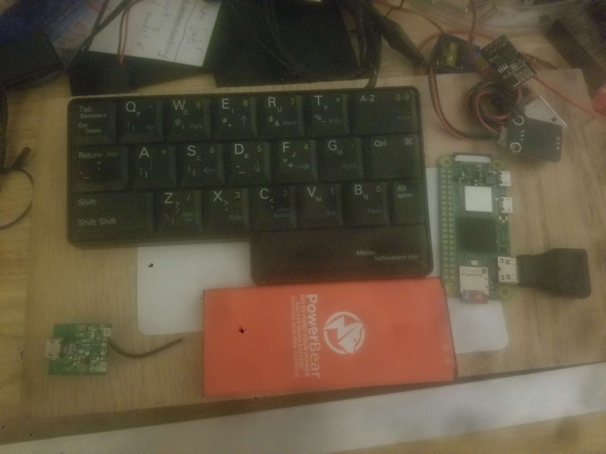

# MP01 - One-Handed Keyboard System - "Keyboard Commander"

| Matios One-Handed Keyboard                                                  | Raspberry Pi Zero 2 W                                                  |
| --------------------------------------------------------------------------- | ---------------------------------------------------------------------- |
|  |  |

I have picked up this fancy and extremely low-profile (but still full size), Matios One-Handed keyboard. I'm going to make it wireless and give it a brain - by usb connectors directly to the usb-connector of a Raspberry pi Zero 2 W with lithium battery charger and 3.7v lithium phone battery.

## Background

The Matias keyboard works by mirroring the keys when holding down the space bar - all the left keys become right keys. It was actually designed for people with disabilities, so overall its pretty intuitive - it's meant for real work. There are some special usage requirements for getting all the special character so i may rework some of the inputs later for coding and electronics control - but that's down the road.

## Project goals

Effectively i want this one-handed keyboard to be a wearable keyboard and small enough i could clip to my pocket. still have full typing control when on the train or doing a presentation. At home i actually want this to work like a universal remote control for my various computers at home (and robotics and electronics projects) by entering a key or some other switch to toggle effortlessly between devices - and then for my keys to be logged and transmitted to that particular device.

Primary Goal Queue:

- [ ] Get IPC services

## OS System

So being as I'm already reviewing all my NetSec material - and being as this device is meant to be a portable wireless keyboard with a brain, and that the Raspberry Pi has a Debian Linux OS and will have some sensitive communication data relating to other systems I own - I will harden this device to be a fully secure utility device. Being as this Raspberry Pi is a small low performance PC - this is an area where Rust's performance acumens makes the most impact.

Features:

- Firewall
- IDS
-

## Software and Networking Protocols

Since this NetSec-Review chapter is largely in the spirit of socket application programming - in Rust - I'm going to try and work some use-cases and experiments. Frankly - I never intended to focus on IPC that much - but in trying to make use-cases for demos in this Review chapter - I do want to trying running the main control system as a elevated background service - and have client control switch modes to port keyboard key-presses, and perhaps other modes and features - encapsulating some of the privileged functions.

At any rate - setting up a unified communication protocol will let me port

Features:

- IPC
  - For IPC - I started her for learning Rust - but I think i would like to work in an IPC service structure that can handle the switching for the keyboard forwarding and other communication protocols - in OS.
  - They that inter-process service can handle each socket connection to each registered device as it's own limited admin process.
    - This will protect the what is basically a raw keylogger
- TCP
  - Obviously for a keyboard we want a reliable protocol where every click matters
- UDP
  - If I add some sort of mouse, joystick, camera feed, etc imu as input - I'll utilize this protocol.

### Feature 1 (Priority) - Full Remote Keyboard Control

- IPC server that is basically a key logger program, but only logging when the 'redirect keyboard input' mode is selected:
  - it will disconnect the existing keyboard input from being read by the kernel
  - it will then route all keyboard input back to the client application
- [IPC Client is TCP Server] - after TCP connection to other PC, will have options like server.rs in Example 3 had, but with an option for RemoteControl
  - When RemoteControl selected, it will use IPC connection to call IPC keylogger Server and set mode 'redirect keyboard input' and start receiving keyboard events
  - Those keyboard events will be forwarded directly to the TCP client
  - (It will need to parse some event key (some rare combo) - to break the mode and reverse the process)
- TCP Client will then take those keyboard events and register them as a virtual keyboard on controlled PC.

#### Security Concerns
- Effectively this involves creating an administrated key-logger - and passing those values (in certain mode) to the client and over a socket connection. 

#### New Rust API/Crates

- [rdev](https://docs.rs/rdev/latest/rdev/) - sort of a more OS eventlistening and sending library (not the best)
- [Enigo](https://github.com/Enigo-rs/Enigo) - input simulation
- [libevdev](https://www.kernel.org/doc/html/v4.12/input/uinput.html) - linux virtual input library
- evdev ([crate](https://docs.rs/evdev/latest/evdev/)) ([GIT](https://github.com/emberian/evdev/tree/main)) - Unix Only - Ok this is the one - it uses libevdev under the hood
  - can both read my inputs on server and be reworked to simulate them on client linux pc.

## Electronics systems

Just leaving this open for modifications to the physical device capabilities.

Features:

- 3.7v lithium battery charger
- 3.7v lithium phone battery
- (maybe) IR blaster
- (maybe) detachable IMU - for mouse.
- (maybe) co-opt my smart watch for mini touch screen
  - It's also got a dial i like (for remote stepper motor control)
- I want some sort of feedback for when entering commands
  - lights, vibration, sound (bluetooth), taping

## Physical device system

In order to make this work, I need to remove the black plate and route a riser the same shape as the keyboard.

## Potential Future Feature

- I believe i can also emulate a bluetooth keyboard - which would work on any system (windows/mac), not just Unix. And would be easier to connect to PCs I don't own (could experiment)
