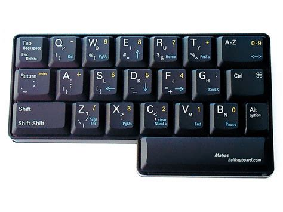
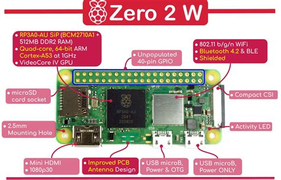
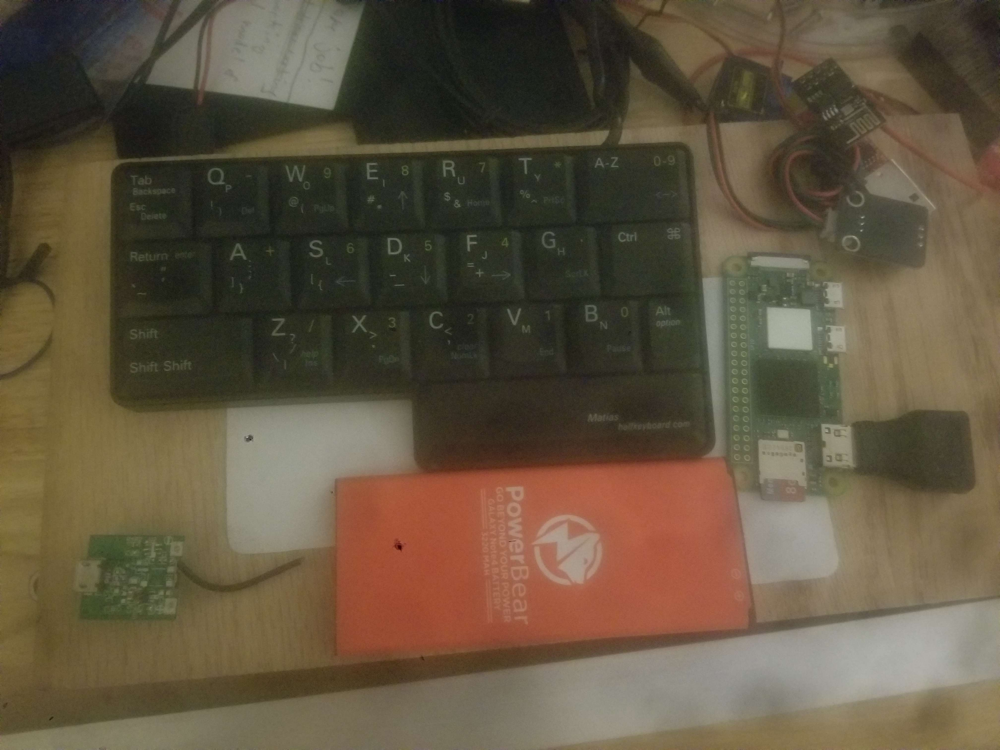

# MP01 - One-Handed Keyboard System - "Keyboard Commander"

| Matios One-Handed Keyboard                                                  | Raspberry Pi Zero 2 W                                                  |
| --------------------------------------------------------------------------- | ---------------------------------------------------------------------- |
|  |  |

I have picked up this fancy and extremely low-profile (but still full size), Matios One-Handed keyboard. I'm going to make it wireless and give it a brain - by usb connectors directly to the usb-connector of a Raspberry pi Zero 2 W with lithium battery charger and 3.7v lithium phone battery.

## Background

The Matias keyboard works by mirroring the keys when holding down the space bar with your thumb. All the left keys are mirrored right keys. It was actually designed for people with disabilities, so overall its pretty intuitive - it's meant for real work. There are some special usage requirements for getting all the special character so i may rework some of the key-mapping later.

## Project goals

Effectively i want this one-handed keyboard to be a wearable keyboard and small enough i could clip to my pocket. still have full typing control when doing a presentation or just messing around.

At home i actually want this to work like a universal remote control several computers at home (and robotics and electronics projects) by entering a key-combo or gpio switch to toggle effortlessly between devices - and then for my keys to be transmitted to that particular device like a wireless keyboard (in that mode).

I should be able to use it for coding (if necessary) and also want modes for use-cases like electronics control and so forth.

Primary Goal Queue:

- [ ] Get IPC admin service working with main user client service
  - [ ] Setup initial Bluetooth or TCP connection link to 1 or more PC.
    - [ ] Secure the Pipe
    - [ ] Setup OOB pairing and authentication to prevent MITM attacks and codify process.
- ...

## Software and Networking Protocols

Since this NetSec-Review chapter is largely in the spirit of socket application programming - in Rust - I'm going to try and work some use-cases and experiments (more then necessary probably).

For IPC - I do want to trying running the main control system as a elevated supervisor service with limited privilege workers (for various connection handling). I'll have some client control to request switch modes to the admin service - which will then port keyboard key-presses, and perhaps other modes and features - encapsulating some of the privileged functions.

At any rate - setting up a unified communication protocol will let me port

Features:

- IPC
  - For IPC - I started her for learning Rust - but I think i would like to work in an IPC service structure that can handle the switching for the keyboard forwarding and other communication protocols - in OS.
  - They that inter-process service can handle each socket connection to each registered device as it's own limited admin process.
    - This will protect the what is basically a raw keylogger
  - dns (crate) has extended capabilities for Unix sockets including fd-passing (tcp connections perhaps), SOCK_SEQPACKET.
    - (Note abstract socket addr is a security concern)
- Bluetooth - The more I've been working with bluetooth protocol - the more this seems like a favoured primary for this project to connect they keyboard to other devices
  - The primary advantage is that Bluetooth already is common for keyboard pairing schemas and instructing other computers
  - And unlike lan based connection schemes - my computer is linked directly to another device (or scatternet) - rather than exposed to a LAN network that has other authorized devices that could perform MITM attacks (and other trickery),
  - RFCOMM works like a reliable protocol - or can be modified with TCP like reliability
- TCP
  - With TCP - the only use-case this could have for now
    - is perhaps wirelessly connecting to my home network and utilizing distributed computing (distributed password cracker or GPU borrowing)
    - Accessing other remote resources
- UDP
  - If I add some sort of mouse, joystick, camera feed, etc imu as input - I'll utilize this protocol.
    - In fact - I better just pick one to demonstrate at least.

## Major Features

### Major Feature 1 (Priority) - Full Remote Keyboard Control

- IPC server that is basically a key logger program, but only logging when the 'redirect keyboard input' mode is selected:
  - it will disconnect the existing keyboard input from being read by the kernel
  - it will then route all keyboard input back to the client application
- [IPC Client is TCP Server] - after TCP connection to other PC, will have options like server.rs in Example 3 had, but with an option for RemoteControl
  - When RemoteControl selected, it will use IPC connection to call IPC keylogger Server and set mode 'redirect keyboard input' and start receiving keyboard events
  - Those keyboard events will be forwarded directly to the TCP client
  - (It will need to parse some event key (some rare combo) - to break the mode and reverse the process)
- TCP Client will then take those keyboard events and register them as a virtual keyboard on controlled PC.

### Major Feature 2 - Electronics based system monitoring with physical notifications
- 

#### Security Concerns

- Effectively this involves creating an administrated key-logger (in certain mode) - and passing those values to the client and over a socket connection.

##### bluetooth

- Restrict certain pairing types SSP
  - My trusted devices should have OOB authenticated P-256 (LinkType=8) or better.
  - My keyboard client connections (when mimicking a bluetooth keyboard) - should have proper restrictive considerations. - aka unidirectional.
  - MITM attacks - during pairing and at existing connections should be mitigated.

#### New Rust API/Crates

- [rdev](https://docs.rs/rdev/latest/rdev/) - sort of a more OS eventlistening and sending library (not the best)
- [Enigo](https://github.com/Enigo-rs/Enigo) - input simulation
- [libevdev](https://www.kernel.org/doc/html/v4.12/input/uinput.html) - linux virtual input library
- evdev ([crate](https://docs.rs/evdev/latest/evdev/)) ([GIT](https://github.com/emberian/evdev/tree/main)) - Unix Only - Ok this is the one - it uses libevdev under the hood
  - can both read my inputs on server and be reworked to simulate them on client linux pc.

## Electronics systems

Just leaving this open for modifications to the physical device capabilities.

Approved Features:

- 3.7v lithium battery charger
- 3.7v lithium phone battery

Potential Features:

- (maybe) IR blaster
- (maybe) detachable IMU - for mouse with right hand.
- (maybe) co-opt my smart watch for mini touch screen
  - It's also got a dial i like (for remote stepper motor control)
- I want some sort of feedback for when entering commands
  - lights, vibration, sound (bluetooth), taping

## OS System

Being as this device is will be a portable wireless keyboard with a new brain with full Linux distro and will have sensitive communication data relating to other systems and networks I own - I will harden this device as much as possible. The Raspberry Pi Zero W2 is a small low performance PC - but that's exactly an area where Rust's performance acumens makes the most impact.

OS setups (to be updated as I go over review material):

- Firewall (I really want locked down confirmed addr schema)
- IDS (With gpio - it would be fun to have physical indicators - sounds, lights, buzzer, vibration)

## Physical device system

- In order to make this work, I need to remove the back plate and route a riser the same shape as the keyboard.
  - I'm attempting to maintain the same shape relatively but I'm comfortable with adding some thickness
- but i also want:
  - A clip for my pocket
  - A front case to protect the keys in transport
    - Could double as a cover to obstruct my fingers (from camera watching typed passwords)
      - like a flexible accordion style pocket for my hand - with spring to cover keyboard when not used

Tasks:

- [ ] Need to cut out my wood riser and plan by electronics layout

## Appendix A - Lee's Electronics (Love this place) - Purchase List

-

## Appendix B - Potential Future Feature or loose notes

- I believe i can also emulate a bluetooth keyboard - which would work on any system (windows/mac), not just Unix. And would be easier to connect to PCs I don't own (could experiment)
- I do actually more more than one client type (proxy client, computational client, )
  - and for a future adjustment to be a botnet functionality (distributed computing)
    - Like for cracking passwords (is a good one) but others - split the work on some heavy computational task
  - and so i want an abstract type and special types - later
- I do want want a connector with ESP01 in case of no-network access to certain devices.
