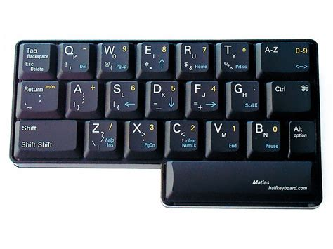
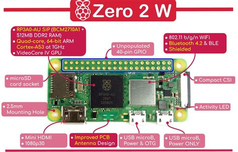

# Network Security Applications Review/Assignments in Rust

## Project Summary and Background

Ok, so I was officially in the [Applied Computer Science (Games Development Option)](https://www.bcit.ca/programs/applied-computer-science-games-development-option-bachelor-of-science-full-time-867absc/) at BCIT. I took the main NetSec programming courses as well (out of pocket) from this set: [Applied Computer Science (Network Security Applications Development Option](https://www.bcit.ca/programs/applied-computer-science-network-security-applications-development-option-bachelor-of-science-full-time-part-time-867bbsc/#courses) out of pocket.

The 2 programs linked there only have 5 specialty courses that differ between programs. The latter 3 below are all laddered (aka sequential dependencies) with COMP 8505 being the top level course and involved expanding on the C2 password cracking botnet we built in COMP 8005 but with more cover capabilities (port knocking, key-logging, etc). Anyway here's the links to the courses in case you are curious:

- [COMP 7003 Introduction to Information and Network Security](https://www.bcit.ca/courses/introduction-to-information-and-network-security-comp-7003/)
- [COMP 7005 Computer Networks and Protocols](https://www.bcit.ca/courses/computer-networks-and-protocols-comp-7005/)
- [COMP 8005 Network and Security Applications Development](https://www.bcit.ca/courses/network-and-security-applications-development-comp-8005/)
- [COMP 8505 Special Topics in Network and Security Development](https://www.bcit.ca/courses/special-topics-in-network-and-security-development-comp-8505/)

I'm not going to create every assignment from this program but I am going review and try and device a bunch of fun utils and programs to build in Rust. For example we built a network proxy application that could mimic bad network conditions, drop packets, create duplicate packets, etc, and then had to build our own reliable protocol from scratch. Essentially build a TCP like protocol from scratch using UDP incorporating many of the techniques that enable TCP to be ... reliable. This one is more academic then practical since i can just use TCP lol - but I'll find a way to extend on topics I already know.

I will be trying to incorporate 1 or 2 new major projects. I've already decided on 1. I picked up this fancy and extremely low-profile full size One-Handed keyboard and a Raspberry pi Zero W2 that I'll make wireless and portable (for fun) and apply some of the lessons here to build a botnet controller of some sort where i can run commands remotely and use a wireless keyboard also - switching between computers on the fly (or multi-cast).

| Matios One-Handed Keyboard                                                  | Raspberry Pi Zero 2 W                                                  |
| --------------------------------------------------------------------------- | ---------------------------------------------------------------------- |
|  |  |

I've created a [Major Project 1](./Major-Project-01_one-hand-keyboard-System.md) document for this - and I will unify these communications protocols into this novel controller.

## Methodology - for this unit

Ok - So I'm reviewing the learning outcomes and materials from the courses mentioned above - I'm still reluctant to put course materials on git but I'll drop in fundamental summaries, and write my own assignments based on course materials. Status list here:

| Checklist | Review                                                                   |
| --------- | ------------------------------------------------------------------------ |
| [x]       | My Review - COMP 7003 Introduction to Information and Network Security   |
| [x]       | My Review - COMP 7005 Computer Networks and Protocols                    |
| [ ]       | My Review - COMP 8005 Network and Security Applications Development      |
| [ ]       | My Review - COMP 8505 Special Topics in Network and Security Development |

<!--
- [Super Summary - COMP 7003 Introduction to Information and Network Security](./comp7003-Summary.md) -->

- [Super Summary - COMP 7005 Computer Networks and Protocols](./comp7005-Summary.md)
<!-- - [My Review - COMP 8005 Network and Security Applications Development](.)
- [My Review - COMP 8505 Special Topics in Network and Security Development](.) -->

<!-- Here's where I'm organizing the total potential demo list:
- [My (potential) Demo List](./NetSec-Review_DemoList.md) -->

## Rust Project Demo Library

### Rust Workspace Structure - Simplified examples for each crate.

So this is a part of 'cargo workspace' that allows my demo crates to all use the same dependencies locally (rather than redundant downloads for each crate) so there's only one target build in NetSec_Review_Workspace, each crate has it's own toml still but on build there is only one download of any overused public crates.

This is ipc example showing only the 00 demo (numbering only for file names). Check each crates README for specific demo details. Binaries contain main entry point functions, libraries contain modules (implementations)

```
ipc
├── Cargo.toml
└── src
    ├── bin
    │   ├── ipc_00_client.rs    // binary for client - 'use ipc::ipc_00::server;'
    │   └── ipc_00_server.rs    // binary for server - 'use ipc::ipc_00::client;'
    ├── ipc_00
    │   ├── client.rs     // library module definition for ipc_00::client
    │   └── server.rs     // library module definition for ipc_00::client
    ├── ipc_00.rs     // idiomatic linkers for 'pub mod client; pub mod server;'
    └── lib.rs    // core library 'pub mod ipc_00;'
```

- Each demo (00) in each topic crate (ipc) will have it's own structure like this, and new ones will increment (01, 02), etc.
- Each demo topic will have it's own README with links to the source. The source only has minimal comments, and the file names are standardized to be each to iterate - so the README explains each example only.

### To run programs

- These may have args and other lib files - check their specific ReadMe for the crate
- binaries are located in /bin folder.
  - Normally binary is just /src/main.rs but i have many demos so they're all stored in /bin and you have to specify which example to run instead (if you want).

```console
// Server:
$ cargo run --bin ipc_00_server
```

```console
// Client:
$ cargo run --bin ipc_00_client
```

### Demo Examples by category

The READMEs will help parse my demo ideas and will also be the location of descriptions for each specific demo, each with links directly to the 4 (or more) main source code sections.

<table cellpadding="0" cellspacing="0"  bgcolor="#090909"   border="1"
  frame="box"   rules="none">
  <tr>
    <td width="66" valign="middle">
      
    </td>
    <td>
   <strong>
      These demos are the source outputs for my practicing of Rust (and some socket programming fundamentals) for this unit.
    </strong>
    </td>
  </tr>
</table>

> [!NOTE]
> List is sequential in terms of my initial attention - meaning - when I work on adding value beyond initial sockets - like authentication/encryption, different models, etc, it will tend to develop organically across topics as my boredom and interests dictates

| # Ex. | Topic / Link                                                              | Status / Notes                  |
| ----: | ------------------------------------------------------------------------- | ------------------------------- |
|     7 | [Domain Sockets (IPC)](./NetSec-Review_workspace/ipc/README_IPC.md)       | Completed all initial examples  |
|     3 | [BLUETOOTH](./NetSec-Review_workspace/bluetooth/README_BLUETOOTH.md)      | In progress (more fun - do now) |
|     0 | [TCP](./NetSec-Review_workspace/tcp/README_TCP.md)                        |                                 |
|     0 | [UDP](./NetSec-Review_workspace/udp/README_UDP.md)                        |                                 |
|     0 | [WebRTC](./NetSec-Review_workspace/webRTC/README_WEBRTC.md)               |                                 |
|     0 | [Raw Sockets - Experimental](./NetSec-Review_workspace/raw/README_RAW.md) |                                 |

- Future possibility
  - ADD COVERT BOTNET CONCERNS (PORT KNOCKING, ETC)
  - I'd really like to do a laser line of sight transmission like they do for audio sometimes.
  - Multi-connection-method manager - with unified application security layer and custom protocol.

<!-- - [x] [Domain Sockets (IPC)](./NetSec-Review_workspace/ipc/README_IPC.md)
- [TCP](./NetSec-Review_workspace/tcp/README_TCP.md) **<- Currently in progress**
- [UDP](./NetSec-Review_workspace/udp/README_UDP.md)
- [BLUETOOTH](./NetSec-Review_workspace/bluetooth/README_BLUETOOTH.md)
- [WebRTC](./NetSec-Review_workspace/webRTC/README_WEBRTC.md)
- [Raw Sockets](./NetSec-Review_workspace/raw/README_RAW.md) - (experimental / lower-level abstractions)
- x means initial passthrough done. -->

## Appendix A: Major Project Ideas

- [Keyboard Commander](./Major-Project-01_one-hand-keyboard-System.md) (My one handed wearable keyboard project)
- My own peer sharing service protocol.
  systemctl list-sockets

## Useful Linux tools

- systemctl list-sockets
