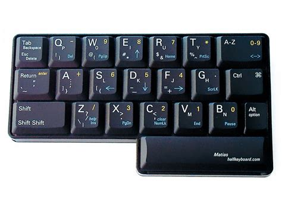
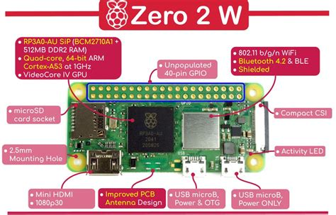

# Network Security Applications Review/Assignments in Rust

## Project Summary and Background

Ok, so I was officially in the [Applied Computer Science (Games Development Option)](https://www.bcit.ca/programs/applied-computer-science-games-development-option-bachelor-of-science-full-time-867absc/) but because I had completed part of the degree part time, then switch to full-time to take Games courses (only offered full-time) - i had extra spots in my schedule and as a great optimizer and opportunity capitalizer - I took NetSec programming courses as well (out of pocket) from this set:

- [Applied Computer Science (Network Security Applications Development Option](https://www.bcit.ca/programs/applied-computer-science-network-security-applications-development-option-bachelor-of-science-full-time-part-time-867bbsc/#courses)

The 2 programs linked there only have about 5 specialty courses that differ between programs. The latter 3 below are all laddered (aka built on top of each other) with COMP 8505 being the top level course and involved expanding on the C2 password cracking botnet we built in COMP 8005 with more cover capabilities. Anyway here's the links to the courses in case you are curious:

- [COMP 7003 Introduction to Information and Network Security](https://www.bcit.ca/courses/introduction-to-information-and-network-security-comp-7003/)
- [COMP 7005 Computer Networks and Protocols](https://www.bcit.ca/courses/computer-networks-and-protocols-comp-7005/)
- [COMP 8005 Network and Security Applications Development](https://www.bcit.ca/courses/network-and-security-applications-development-comp-8005/)
- [COMP 8505 Special Topics in Network and Security Development](https://www.bcit.ca/courses/special-topics-in-network-and-security-development-comp-8505/)

So anyway - I'm not going to create every assignment from this program - but I do want to gain enough familiarity with using Rust while reviewing the material. I'm basically going to crash course review all the assignments in about a week and see where we're at. Many of the application we built in the courses were about reaffirming the learning outcomes - but don't have no real world practical value to me now.

For example we built a network proxy application that could mimic bad network conditions, drop packets, create duplicate packets, etc, and then had to build our own reliable protocol from scratch. Essentially we built TCP from scratch using UDP incorporating many of the techniques that enable TCP to ... reliable. I probably won't recreate this one simple because i could just use TCP if reliability is a concern. Capiche! ....

But I do want build things custom networking applications using Rust. For example, I have picked up this fancy and extremely low-profile, but still full size, Matios One-Handed keyboard and Raspberry pi Zero 2 W. I'm going to wire this baby up with battery, and make it wireless and wearable (for fun). And then setup a remote protocol to run commands remotely using wifi or bluetooth - perhaps switching between computers on the fly. But that's a future project (built off the back of this review and exercise)

| Matios One-Handed Keyboard                                                  | Raspberry Pi Zero 2 W                                                  |
| --------------------------------------------------------------------------- | ---------------------------------------------------------------------- |
|  |  |

## Methodology - for this unit

Ok - So I'm reviewing the learning outcomes and materials from the courses mentioned above - I'm still reluctant to put an course materials on git - and it's too verbose - but I'll drop in fundamental summaries, and write my own assignments based on course materials as I go forward.

| Checklist | Review |
|---|---|
| [x] | My Review - COMP 7003 Introduction to Information and Network Security |
| [x] | My Review - COMP 7005 Computer Networks and Protocols |
| [ ] | My Review - COMP 8005 Network and Security Applications Development |
| [ ] | My Review - COMP 8505 Special Topics in Network and Security Development |

<!-- 
- [Super Summary - COMP 7003 Introduction to Information and Network Security](./comp7003-Summary.md) -->
- [Super Summary - COMP 7005 Computer Networks and Protocols](./comp7005-Summary.md)
<!-- - [My Review - COMP 8005 Network and Security Applications Development](.)
- [My Review - COMP 8505 Special Topics in Network and Security Development](.) -->

Here's where I'm organizing the total potential demo list:
- [My (potential) Demo List](./NetSec-Review_DemoList.md)

## Default/Built-In Tool Chain

- Bluetooth
  - [My hcitool notes](./Tools-Review/hcitool-notes.md)
  - [bluetoothctl guide](https://hadess.github.io/bluez/bluetoothctl.html)


## Rust Project Demo Library

### Rust project hierarchy - Simplified example for each crate. 
Remember this is part of a larger 'cargo workspace' 
- so there's only one target built in NetSec_Review_Workspace
- each crate has it's own toml but on build there is only one download of dependencies for all crates in workspace (save resources)
- This is ipc example showing only the 00 demo (numbering only for file names)
- Check each crates README for specific demo details 
- binaries contain main functions, libraries contain modules (implementations)
```
ipc
├── Cargo.toml
└── src
    ├── bin
    │   ├── ipc_00_client.rs    // binary for client - 'use ipc::ipc_00::server;' 
    │   └── ipc_00_server.rs    // binary for server - 'use ipc::ipc_00::client;' 
    ├── ipc_00
    │   ├── client.rs     // library module definition for ipc_00::client
    │   └── server.rs     // library module definition for ipc_00::client
    ├── ipc_00.rs     // idiomatic linkers for 'pub mod client; pub mod server;'
    └── lib.rs    // core library 'pub mod ipc_00;'
```
- Each crate will have it's own make up like this but various examples starting at '00_' for the basic one, etc.
- Each will have it's own README

### To run programs
- These may have arguments later - check their specific ReadMe for the crate
- binaries are located in /bin folder. 
  - Normally binary is just /src/main.rs, 
    - but i have many examples stored in /bin 
    - so you have to specify which example to run instead.
```console
// Server:
$ cargo run --bin ipc_00_server
```
```console
// Client:
$ cargo run --bin ipc_00_client
```

### Demo Examples by category

These READMEs will help parse my demo ideas and will also be the location of descriptions for each one. There are also links directly to the 4 main source code sections for each demo within the README.

> ![NOTE]
> IPC apps will probably get the most attention for learning rust and playing around with sockets. 
> This is because it doesn't require an actual network and therefore I don't need to test networking to test logical code problem and various communication related activities.
> However, everything done in IPC could easily be ported to the other socket examples - it just reduces complexity for anything but purposeful production work. 

- [Domain Sockets (IPC)](./NetSec-Review_workspace/ipc/README_IPC)
- [TCP](./NetSec-Review_workspace/tcp/README_TCP.md)
- [UDP](./NetSec-Review_workspace/udp/README_UDP.md)
- [BLUETOOTH](./NetSec-Review_workspace/bluetooth/README_BLUETOOTH.md)
- [WebRTC](./NetSec-Review_workspace/webRTC/README_WEBRTC.md)
- [Raw Sockets](./NetSec-Review_workspace/raw/README_RAW.md) - (experimental / lower-level abstractions)

