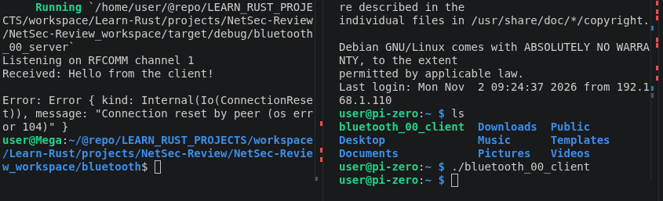
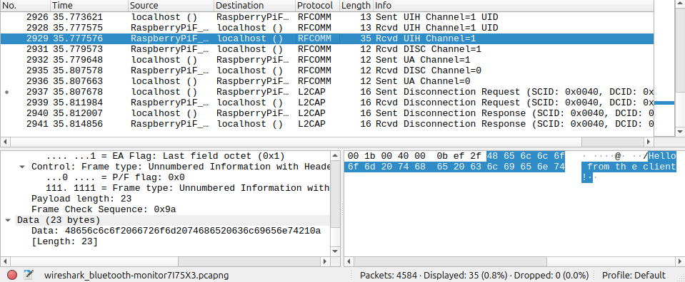
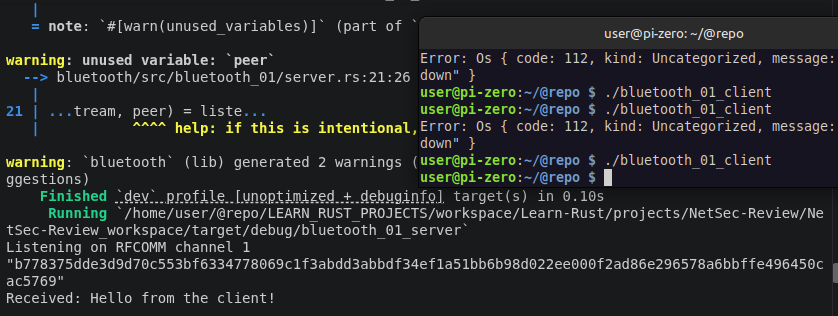
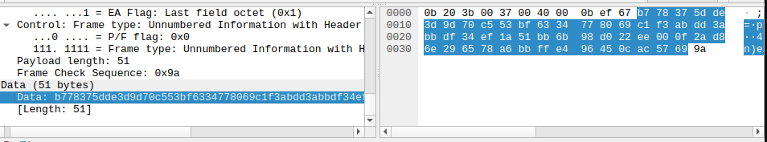
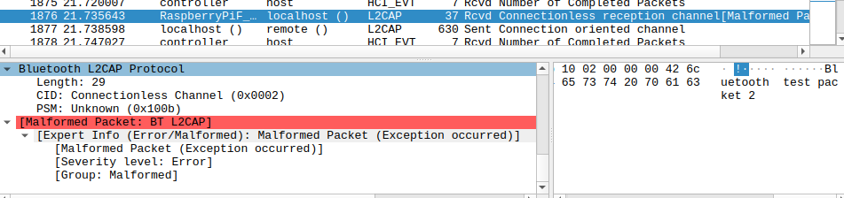
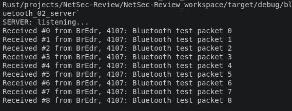
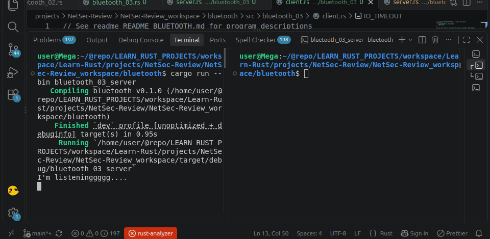

# Bluetooth demos crate

It should be noted that Rust is just interfacing with Linux for native capabilities like this.

- the BlueR (Rust) is built off BlueZ (Linux library) as basically a wrapper.
- However, there's still value in Rust's attention to safety and security - and practicality in building a unified operator - as well as adding value in the pipe via extended protocols.

## Rust specific Bluetooth crates/API

- Default Linux is Bluez (bluetoothctl (preferred) and hcitool (older))
- [BlueR (Crate)](https://docs.rs/bluer/latest/bluer/)
  - [BlueR (Git)](https://github.com/bluez/bluer)
  - Built on [tokio (Crate)](https://docs.rs/tokio/1.52.3/tokio/) asynchronous runtime.
- CPAL - Cross-Platform Audio Library
  - [cpal (Crate)](https://docs.rs/cpal/latest/cpal/)
  - [cpal (git)](https://github.com/RustAudio/cpal)

## Appendices (Just to keep top example focused)

- [Appendix A - Demo Example Options](#appendix-a---demo-example-options)
- [Appendix B - Bluetooth Resources](#appendix-b---bluetooth-resources)

## Build notes - for testing raspberry pi

```console
// In order to build for another device you have to install cross.
// uname -m on pi was: aarch64
// podman must be installed
cross build --release --target aarch64-unknown-linux-gnu --bin bluetooth_00_client
```

I also needed to place a Cross.toml in my cargo workspace root - to install the bluetooth package required for BlueR

```toml
[target.aarch64-unknown-linux-gnu]
pre-build = [
    "dpkg --add-architecture $CROSS_DEB_ARCH",
    "apt-get update",
    "apt-get install --assume-yes libdbus-1-dev:$CROSS_DEB_ARCH",
]
```

> [!Note] env.rs is a file I created in place of .env to add to gitignore to hide my MAC - will probably be present in most examples but absent from git, you can just hardcode a mac if anyone actually runs these locally.

> [!Important] One thing that makes bluetooth connections different than wifi - is that after pairing with the network - you don't maintain that connection - it only become live whenever a service requests it. On the Pi with graphical interface it stays up (once computers are connected) - but in headless mode - these examples below - will only connect to run the service and if the client process ends, so will the connection.

## Example 1 - Initial connection, setup and message transfer.

### Summary

Moving on from IPC, and working towards my Major Project 1, I've setup my Raspberry Pi Zero 2 W to handing further socket programming examples P2P rather than IPC. First things first - I'm going to manage the connection and do a message transfer via the bluetooth connection.

### Implementation Notes

- So basic example just to get initial channel working.
  - Manually paired and connected server and pi computers
  - Had to build for the pi specifically (see above)
  - env.rs is a file I created in place of .env to add to gitignore to hide my MAC
  - uses RFCOMM (which is the default modern socket type for PC to PC channel (connection based))
  - my_bluer.rs has a scan function I tested but not important for example 1
    - It will be the library for a more comprehensive application later.

### New Rust API/Crates

- [tokio (Crate)](https://docs.rs/tokio/1.52.3/tokio/)

### Rust language feature used:

- async/await

### Bluetooth Protocol

- Bluetooth Classic RFCOMM (connection oriented byte stream)

### Source / Outcome

| Role     | Library                                                    | Binary                                                     | Description                    |
| -------- | ---------------------------------------------------------- | ---------------------------------------------------------- | ------------------------------ |
| Client   | [bluetooth_00/client.rs](./src/bluetooth_00/client.rs)     | [bluetooth_00_client.rs](./src/bin/bluetooth_00_client.rs) |                                |
| Server   | [bluetooth_00/server.rs](./src/bluetooth_00/server.rs)     | [bluetooth_00_server.rs](./src/bin/bluetooth_00_server.rs) |                                |
| my_bluer | [bluetooth_00/my_bluer.rs](./src/bluetooth_00/my_bluer.rs) |                                                            | My Bluetooth utility functions |


_Shows "Received: Hello from the client!" on server before connection dropped purposefully_



_Shows data in transit via wireshark_

### Addendum

In the wireshark readout - there are 14 l2cap protocol source/desc setting up the connection, then 17 rfcomm protocol including the data transfer, and then 4 l2cap for the disconnect (send/rev) requests. There are also controller/host packet including "Encryption Enable: Link Level Encryption is ON (0x01)". Anyway - it indicates we have link level encryption, but as we can see the message in plaintext in wireshark - we know that message is being decrypted after transmission in the blueZ stack.

```console
$ btmgmt info
hci0:   Primary controller
        (shows mac - I removed)
        supported settings: powered connectable fast-connectable discoverable bondable link-security ssp br/edr le advertising secure-conn debug-keys privacy configuration static-addr phy-configuration
        current settings: powered ssp br/edr le secure-conn
hci0:   Configuration options
        supported options: public-address

// ssp: Secure Simple Pairing is enabled for BR/EDR.
// br/edr: Bluetooth Classic is enabled.
// le: Bluetooth Low Energy is enabled.
// secure-conn: Secure Connections is enabled on the controller.
```

It's important to note that the pi and my server are negotiating security based on what each can (or willing) to provide at pairing time. You can see the encryption for each option above here [Understanding Bluetooth Security](https://unam.re/blog/understanding-bluetooth-security-i)

Anyway - Doing a little investigation, my Link Key type for this pairing was showing 4 indicating SSP connection which means unauthenticated (because i didn't want to hook up a keyboard on the pi :P) - Encryption algorithm: P-192 elliptic-curve cryptography. - Authentication: No MITM protection was established during pairing. - Effectively if someone was spoofing my MAC - this could have established a middle man connection during pair possibly (whoops - you can have security or laziness - not both)

Final futureZac notes:

- I'll setup a proper secure connection that will give me P-256 using OOB (Out-Of-Bound) pairing since i have physical access to both devices.
- I'll add some application layer encryption - will ensure my data on the wire would be obfuscated from both a MITM attacker and/or the HCI on either system.
- I will look at forbidding lesser connection types on my keyboard controller for MP1 (or set some restrictions for future use of lesser pairing key types) to harden my final project.

## Example 2 - Protect the pipe!

Alright - so now I just want to add some encryption to the application layer to protect my application from any awesome hackers that may have MITM my poorly paired bluetooth connection (from the last example). Those ruffians.

### Implementation Notes

- I'm going to start with an AES256_GCM encryption from the same named package on Rust.
- I've added new library my_cryptor for the encryption and decryption functions.
- I'm just using nonsense 32B key using Rust's range syntax "[7u8; 32]" for filling 7s as unsigned 8-bit, 32 element array [7, 7, 7, 7, ...] etc, 32 times.
  - This should be a random generated key for real use.

### New Rust API/Crates

- [aes_gcm (Crate)](https://docs.rs/aes-gcm/latest/aes_gcm/)
  - I also looked at this [AES Encryption in Rust](https://www.rustfaq.org/en/how-to-use-aes-encryption-in-rust/) for added context

### Bluetooth Protocol

| Role       | Library                                                        | Binary                                                     | Description             |
| ---------- | -------------------------------------------------------------- | ---------------------------------------------------------- | ----------------------- |
| Client     | [bluetooth_01/client.rs](./src/bluetooth_01/client.rs)         | [bluetooth_01_client.rs](./src/bin/bluetooth_01_client.rs) |                         |
| Server     | [bluetooth_01/server.rs](./src/bluetooth_01/server.rs)         | [bluetooth_01_server.rs](./src/bin/bluetooth_01_server.rs) |                         |
| my_bluer   | [bluetooth_01/my_bluer.rs](./src/bluetooth_01/my_bluer.rs)     |                                                            |                         |
| my_cryptor | [bluetooth_01/my_cryptor.rs](./src/bluetooth_01/my_cryptor.rs) |                                                            | AES-GSM encrypt/decrypt |





## Example 3 - L2CAP Datagram packets

### Summary

Ok - So in the previous examples I did RFCOMM which is a byte stream protocol similar to a serial connection. However, thinking of cool use-cases, and one is using real time data. I was thinking it would be fun to route my microphone feed from one computer to another and play on the others speakers (could be fun to use my smart watch one day like a loud speaker) - but at any rate it it a flimsy excuse/opportunity to try the connection-less Datagram protocol on the L2CAP layer.

Datagrams are more suitable for real-time relevant data where missing or delayed packets can be ignored - such as is common for live calls and video - you might see some distortion if the connection goes bad, but getting those missing packets after the fact is not going to improve your experience (the moment has passed).

### Implementation Notes

You'd think this would be one of the easier ones... but it tripped my up for a few reasons - and troubleshooting made me feel like Sideshow Bob getting smacked in the face with those bloody rakes.


The primary issue with datagrams for this example is that they are connection-less (with regard to the socket) and with bluetooth specifically (rather than wifi), you (or the OS) are also managing connections to devices specifically. With wifi (or lan) connection - you're assumed to be always maintaining a persistent connection. But with bluetooth on some environments the devices will only remain connected to the other device if there's a service that's actively wanting to use the connection for some purpose, if not, you see your device disconnect automatically when the process dies. Because datagrams are connection-less (and apparently less common on bluetooth to work with directly), they aren't registered as a service like the connection based protocols are and don't trigger the (bluetooth) connection automatically - without a registered service maintaining it.

- After much annoying rakes in the face (and researching) - there are ways to manually register datagram based services that could maintain the connection on a linux PC - but I was starting to get in the weeds for a one-time (perhaps) example.
- For now I was able to get this working on the raspberry pi only by loading the desktop-manager (aka desktop booted up (non-headless mode)). I was able to connect to the pi and maintain the connection I guess because something in the desktop environment captures it.

So at any rate - I could run my base experiment - but being as this took me longer than expected - and that even other real-time concerned protocols use a low latency RFCOMM style connection - I will push an audio passthrough service to a future fun example.

PSM means Protocol/Service Multiplexer. It’s the L2CAP equivalent of a port number (0x0001–0x0EFF)

### Source

| Role       | Library                                                        | Binary                                                     | Description             |
| ---------- | -------------------------------------------------------------- | ---------------------------------------------------------- | ----------------------- |
| Client     | [bluetooth_02/client.rs](./src/bluetooth_02/client.rs)         | [bluetooth_02_client.rs](./src/bin/bluetooth_02_client.rs) |                         |
| Server     | [bluetooth_02/server.rs](./src/bluetooth_02/server.rs)         | [bluetooth_02_server.rs](./src/bin/bluetooth_02_server.rs) |                         |
| my_bluer   | [bluetooth_02/my_bluer.rs](./src/bluetooth_02/my_bluer.rs)     |                                                            |                         |
| my_cryptor | [bluetooth_02/my_cryptor.rs](./src/bluetooth_02/my_cryptor.rs) |                                                            | AES-GSM encrypt/decrypt |

### Outcome



_malformed packet - but working send example with l2cap datagrams_



_server (receiver) output_

---

<table cellpadding="0" cellspacing="0"  bgcolor="#090909"   border="1"
  frame="box"   rules="none">
  <tr>
    <td width="66" valign="middle">
      
    </td>
    <td>
   <strong>
Ok - so I actually got super distracted playing around with bluetooth devices, particularly ps4 controls that were having a connect and then disconnect problem - but anyway went down a rabbit hole but learned more about bluetooth input devices, and studying how input system system works on linux, troubleshooting my connection with btmon, witnessing the HID layer and it's communication, udevadm, etc. - I was finally able to get these up on headless mode (I honestly think it was just updates that resolved it). Also did you know a ps4 controller has a touchpad and works by default as mouse on the pc desktop? Anyway... back to our regularly scheduled Rustling...
    </strong> 
    </td>
  </tr>
</table>

---

## Example 4 - L2CAP (SeqPacket)

Let's do a basic example with L2CAP (SeqPacket) - this aristo-packet stamps that envelope with his family wax (jk) - aka - but it gives you crisp message boundaries.

SeqPacket is best suited for state updates, or control inputs, etc - reliable (application oriented) ideally non-continuous data that you might want to build quickly with crisp message boundaries, rather than a stream delimited like serial connection. 

To spice this one up - I'm going to see what other data we can get - and maybe add some extra data - let's say... checking latency and jitter, recording round-trip times (min/max,average), timestamps... and just get all the data i can.

### Implementation Notes

- This one i had some tricky connection issues - acting same as the datagram packets - like I simply couldn't connect headless or with display manager up and present connection - a connection style packet on a common service should do that automatically. 
  - I realized one difference is that I'm doing LE (low-energy) connection. On LE rather than bluetooth classic connection - you have to tell your adapter to advertise - that way the client can properly reach the server. This happens in lieu of a SDP record (that you would have to setup for classic bluetooth - if not a common (already setup) protocol).
- Anyway - Program just pings the server the reply just echos the packet - and the client then times the responses, stores them - and gives you stats at the end for session. 50 packets

### Source

| Role       | Library                                                        | Binary                                                     | Description             |
| ---------- | -------------------------------------------------------------- | ---------------------------------------------------------- | ----------------------- |
| Client     | [bluetooth_03/client.rs](./src/bluetooth_03/client.rs)         | [bluetooth_03_client.rs](./src/bin/bluetooth_03_client.rs) |                         |
| Server     | [bluetooth_03/server.rs](./src/bluetooth_03/server.rs)         | [bluetooth_03_server.rs](./src/bin/bluetooth_03_server.rs) |                         |
| my_bluer   | [bluetooth_03/my_bluer.rs](./src/bluetooth_03/my_bluer.rs)     |                                                            |                         |
| my_cryptor | [bluetooth_03/my_cryptor.rs](./src/bluetooth_03/my_cryptor.rs) |                                                            | AES-GSM encrypt/decrypt |

### Outcome


## Example 5 - SCO/eSCO Synchronous Connection-Oriented; eSCO

- This is actually what's used for real time calling.
- This is the one I'll try and do an audio path through for foreign speakers.
- SCO/eSCO - does something SOCK_DGRAM does not - Bluetooth reserves recurring radio slots for the link, so audio arrives on a regular schedule.
  - L2CAP datagram uses the ordinary ACL data link which sends packets in available radio opportunities rather than reserving a recurring slot.
- (technically this could be used for non-audio realtime data for bluetooth...)

## Example 5 - Using GATT for BLE (Bluetooth Low Energy)

- Probably with ESP01 + IMU (later project)

## Example 6 - Bluetooth Mesh Example ??

- It's cool - but

## Appendix A - Demo Example Options

(will fill from other private doc after)

## Appendix B - Bluetooth Resources

- Bluez - Default/Built-In Tool Chain
  - [bluetoothctl guide](https://hadess.github.io/bluez/bluetoothctl.html) - is generally the preferred tool in newer distributions.
  - [My hcitool notes](./Tools-Review/hcitool-notes.md) - legacy
  - [btmon - Bluetooth monitor](https://hadess.github.io/bluez/btmon.html) - debugging discovery and connection
  - [rctest - RFCOMM testing](https://hadess.github.io/bluez/rctest.html)
  - [l2ping - Send L2CAP echo request and receive answer](https://hadess.github.io/bluez/l2ping.html)
  - [btattach - Attach serial devices to BlueZ stack](https://hadess.github.io/bluez/btattach.html) - Bringing up a board’s Bluetooth module wired over a UART.
  - [isotest - test Isochronous (CIS/BIS) communications on BlueZ](https://hadess.github.io/bluez/isotest.html) - Development or diagnostics for Bluetooth audio transport.
  - [btmgmt](https://hadess.github.io/bluez/btmgmt.html) - Inspecting controller capabilities or changing low-level settings.
    - Not installed by default
      - [hid2hci - Bluetooth HID to HCI mode switching utility](https://hadess.github.io/bluez/hid2hci.html) - not installed by default
      - [bdaddr - changing the Bluetooth device address](https://hadess.github.io/bluez/bdaddr.html)
- [Bluetooth - Mesh Protocol](https://www.bluetooth.com/wp-content/uploads/Files/Specification/HTML/MshPRT_v1.1/out/en/index-en.html)
- [Bluetooth-Frame Structure](https://www.geeksforgeeks.org/computer-networks/bluetooth-frame-structure/)
- [Bluetooth Protocol List](https://en.wikipedia.org/wiki/List_of_Bluetooth_protocols)
- Linux Audio tool chain
  - wpctl - WirePlumber Control CLI - See audio sinks on system
  - wpctl status
  - pactl - PulseAudio Control CLI -
    - pactl list short sources
    - pactl list short sinks
