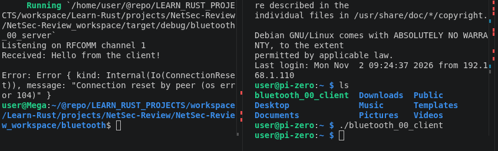
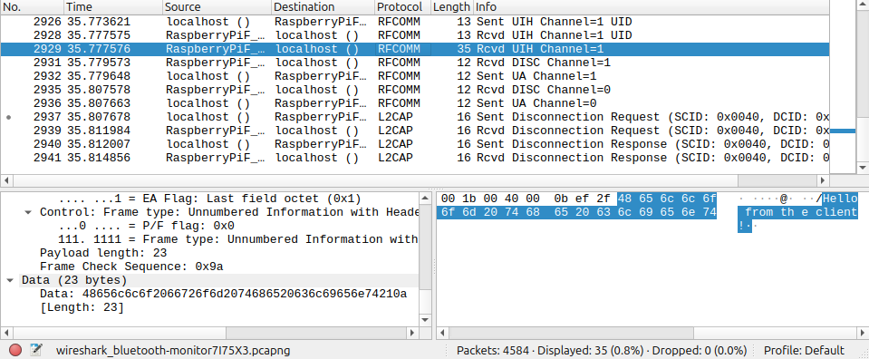
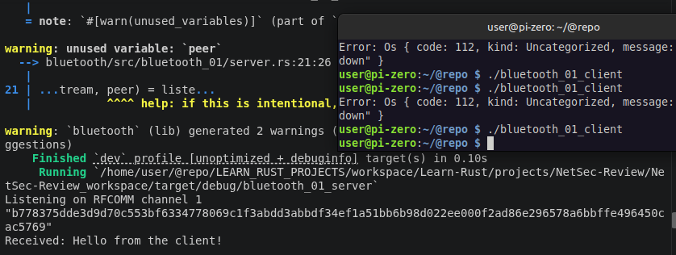
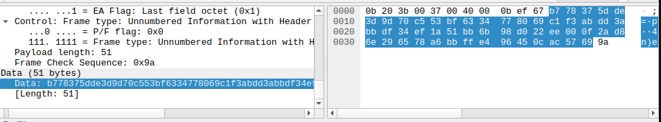
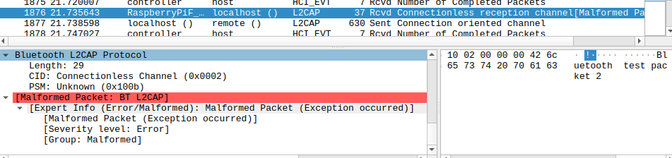
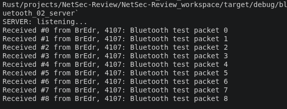
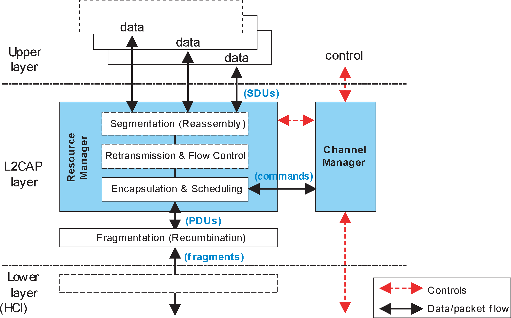
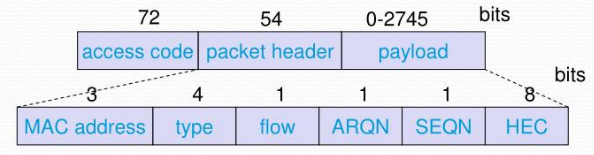

# Bluetooth demos crate

It should be noted that Rust is just interfacing with Linux for native capabilities like this.

- the BlueR (Rust) is built off BlueZ (Linux library) as basically a wrapper.
- However, there's still value in Rust's attention to safety and security - and practicality in building a unified operator - as well as adding value in the pipe via extended protocols.

## Rust specific Bluetooth crates/API

- Default Linux is Bluez (bluetoothctl (preferred) and hcitool (older))
- [BlueR (Crate)](https://docs.rs/bluer/latest/bluer/)
  - [BlueR (Git)](https://github.com/bluez/bluer)
  - Built on [tokio (Crate)](https://docs.rs/tokio/1.52.3/tokio/) asynchronous runtime.
- CPAL - Cross-Platform Audio Library
  - [cpal (Crate)](https://docs.rs/cpal/latest/cpal/)
  - [cpal (git)](https://github.com/RustAudio/cpal)

## Appendices (Just to keep top example focused)

- [Appendix A - Demo Example Options](#appendix-a---demo-example-options)
- [Appendix B - Bluetooth Resources](#appendix-b---bluetooth-resources)

## Build notes - for testing raspberry pi

```console
// In order to build for another device you have to install cross.
// uname -m on pi was: aarch64
// podman must be installed
cross build --release --target aarch64-unknown-linux-gnu --bin bluetooth_00_client
```

I also needed to place a Cross.toml in my cargo workspace root - to install the bluetooth package required for BlueR

```toml
[target.aarch64-unknown-linux-gnu]
pre-build = [
    "dpkg --add-architecture $CROSS_DEB_ARCH",
    "apt-get update",
    "apt-get install --assume-yes libdbus-1-dev:$CROSS_DEB_ARCH",
]
```

> [!Note] env.rs is a file I created in place of .env to add to gitignore to hide my MAC - will probably be present in most examples but absent from git, you can just hardcode a mac if anyone actually runs these locally.

> [!Important] One thing that makes bluetooth connections different than wifi - is that after pairing with the network - you don't maintain that connection - it only become live whenever a service requests it. On the Pi with graphical interface it stays up (once computers are connected) - but in headless mode - these examples below - will only connect to run the service and if the client process ends, so will the connection.

## Example 1 - Initial connection, setup and message transfer.

### Summary

Moving on from IPC, and working towards my Major Project 1, I've setup my Raspberry Pi Zero 2 W to handing further socket programming examples P2P rather than IPC. First things first - I'm going to manage the connection and do a message transfer via the bluetooth connection.

### Implementation Notes

- So basic example just to get initial channel working.
  - Manually paired and connected server and pi computers
  - Had to build for the pi specifically (see above)
  - env.rs is a file I created in place of .env to add to gitignore to hide my MAC
  - uses RFCOMM (which is the default modern socket type for PC to PC channel (connection based))
  - my_bluer.rs has a scan function I tested but not important for example 1
    - It will be the library for a more comprehensive application later.

### New Rust API/Crates

- [tokio (Crate)](https://docs.rs/tokio/1.52.3/tokio/)

### Rust language feature used:

- async/await

### Bluetooth Protocol

- Bluetooth Classic RFCOMM (connection oriented byte stream)

### Source / Outcome

| Role     | Library                                                    | Binary                                                     | Description                    |
| -------- | ---------------------------------------------------------- | ---------------------------------------------------------- | ------------------------------ |
| Client   | [bluetooth_00/client.rs](./src/bluetooth_00/client.rs)     | [bluetooth_00_client.rs](./src/bin/bluetooth_00_client.rs) |                                |
| Server   | [bluetooth_00/server.rs](./src/bluetooth_00/server.rs)     | [bluetooth_00_server.rs](./src/bin/bluetooth_00_server.rs) |                                |
| my_bluer | [bluetooth_00/my_bluer.rs](./src/bluetooth_00/my_bluer.rs) |                                                            | My Bluetooth utility functions |


_Shows "Received: Hello from the client!" on server before connection dropped purposefully_



_Shows data in transit via wireshark_

### Addendum

In the wireshark readout - there are 14 l2cap protocol source/desc setting up the connection, then 17 rfcomm protocol including the data transfer, and then 4 l2cap for the disconnect (send/rev) requests. There are also controller/host packet including "Encryption Enable: Link Level Encryption is ON (0x01)". Anyway - it indicates we have link level encryption, but as we can see the message in plaintext in wireshark - we know that message is being decrypted after transmission in the blueZ stack.

```console
$ btmgmt info
hci0:   Primary controller
        (shows mac - I removed)
        supported settings: powered connectable fast-connectable discoverable bondable link-security ssp br/edr le advertising secure-conn debug-keys privacy configuration static-addr phy-configuration
        current settings: powered ssp br/edr le secure-conn
hci0:   Configuration options
        supported options: public-address

// ssp: Secure Simple Pairing is enabled for BR/EDR.
// br/edr: Bluetooth Classic is enabled.
// le: Bluetooth Low Energy is enabled.
// secure-conn: Secure Connections is enabled on the controller.
```

It's important to note that the pi and my server are negotiating security based on what each can (or willing) to provide at pairing time. You can see the encryption for each option above here [Understanding Bluetooth Security](https://unam.re/blog/understanding-bluetooth-security-i)

Anyway - Doing a little investigation, my Link Key type for this pairing was showing 4 indicating SSP connection which means unauthenticated (because i didn't want to hook up a keyboard on the pi :P) - Encryption algorithm: P-192 elliptic-curve cryptography. - Authentication: No MITM protection was established during pairing. - Effectively if someone was spoofing my MAC - this could have established a middle man connection during pair possibly (whoops - you can have security or laziness - not both)

Final futureZac notes:

- I'll setup a proper secure connection that will give me P-256 using OOB (Out-Of-Bound) pairing since i have physical access to both devices.
- I'll add some application layer encryption - will ensure my data on the wire would be obfuscated from both a MITM attacker and/or the HCI on either system.
- I will look at forbidding lesser connection types on my keyboard controller for MP1 (or set some restrictions for future use of lesser pairing key types) to harden my final project.

## Example 2 - Protect the pipe!

Alright - so now I just want to add some encryption to the application layer to protect my application from any awesome hackers that may have MITM my poorly paired bluetooth connection (from the last example). Those ruffians.

### Implementation Notes

- I'm going to start with an AES256_GCM encryption from the same named package on Rust.
- I've added new library my_cryptor for the encryption and decryption functions.
- I'm just using nonsense 32B key using Rust's range syntax "[7u8; 32]" for filling 7s as unsigned 8-bit, 32 element array [7, 7, 7, 7, ...] etc, 32 times.
  - This should be a random generated key for real use.

### New Rust API/Crates

- [aes_gcm (Crate)](https://docs.rs/aes-gcm/latest/aes_gcm/)
  - I also looked at this [AES Encryption in Rust](https://www.rustfaq.org/en/how-to-use-aes-encryption-in-rust/) for added context

### Bluetooth Protocol

| Role       | Library                                                        | Binary                                                     | Description             |
| ---------- | -------------------------------------------------------------- | ---------------------------------------------------------- | ----------------------- |
| Client     | [bluetooth_01/client.rs](./src/bluetooth_01/client.rs)         | [bluetooth_01_client.rs](./src/bin/bluetooth_01_client.rs) |                         |
| Server     | [bluetooth_01/server.rs](./src/bluetooth_01/server.rs)         | [bluetooth_01_server.rs](./src/bin/bluetooth_01_server.rs) |                         |
| my_bluer   | [bluetooth_01/my_bluer.rs](./src/bluetooth_01/my_bluer.rs)     |                                                            |                         |
| my_cryptor | [bluetooth_01/my_cryptor.rs](./src/bluetooth_01/my_cryptor.rs) |                                                            | AES-GSM encrypt/decrypt |





## Example 3 - L2CAP Datagram packets

### Summary

Ok - So in the previous examples I did RFCOMM which is a byte stream protocol similar to a serial connection. However, thinking of cool use-cases, and one is using real time data. I was thinking it would be fun to route my microphone feed from one computer to another and play on the others speakers (could be fun to use my smart watch one day like a loud speaker) - but at any rate it it a flimsy excuse and and opportunity to try the connection-less Datagram protocol on the L2CAP layer.

Datagrams are more suitable for real-time relevant data where missing or delayed packets can be ignored - such as is common for live calls and video - you might see some distortion if the connection goes bad, but getting those missing packets after the fact is not going to improve your experience (the moment has passed).

### Implementation Notes

You'd think this would be one of the easier ones... but it tripped my up for a few reasons - and troubleshooting made me feel like Sideshow Bob getting smacked in the face with those bloody rakes.


The primary issue with datagrams for this example is that they are connection-less (with regard to the socket). However with bluetooth specifically you are also managing connections to devices specifically. Dealing with wifi - you're maintaining a persistent connection. But with bluetooth the devices will only remain connected to the other device if there's a service that's actively using the the connection for some purpose, if not, you see your device disconnect. Because datagrams are connection-less (and apparently less common on bluetooth to work with directly), they don't in themselves trigger the connection when running tction will not stay up without a registered service maintaining it.

- After much annoying rakes in the face (and researching) - there are ways to manually register datagram based services that could maintain the connection on a linux PC - but for now I was able to get this working on the raspberry pi only by loading the desktop-manager (aka desktop booted up (non-headless mode)). I was able to maintain a connection to the pi - without explicit service running, because something in the desktop environment captures it - and bluetoothctl maintains the connection when instructed.
- Apparently HSP/HFP actually doesn't use datagram, they use RFCOMM... so fun fact I built code example rare. (also this might explain why i was getting malformed packet indicators in wireshark...(but it did work))

So at any rate I could run my base experiment now - but being as this took me longer than expected - and that even other realtime protocols use a low latency RFCOMM style connection - I will push an audio passthrough service to a future fun example.

### Source

| Role       | Library                                                        | Binary                                                     | Description             |
| ---------- | -------------------------------------------------------------- | ---------------------------------------------------------- | ----------------------- |
| Client     | [bluetooth_02/client.rs](./src/bluetooth_02/client.rs)         | [bluetooth_02_client.rs](./src/bin/bluetooth_02_client.rs) |                         |
| Server     | [bluetooth_02/server.rs](./src/bluetooth_02/server.rs)         | [bluetooth_02_server.rs](./src/bin/bluetooth_02_server.rs) |                         |
| my_bluer   | [bluetooth_02/my_bluer.rs](./src/bluetooth_02/my_bluer.rs)     |                                                            |                         |
| my_cryptor | [bluetooth_02/my_cryptor.rs](./src/bluetooth_02/my_cryptor.rs) |                                                            | AES-GSM encrypt/decrypt |

### Outcome



_malformed packet - but working send example with l2cap datagrams_



_server (receiver) output_

## Example 4 - L2CAP (SeqPacket)

TODO

## Example 5 - Using GATT for BLE (Bluetooth Low Energy)

- Probably with ESP01 + IMU (later project)

## Example 6 - Bluetooth Mesh Example ??

- It's cool - but

## Appendix A - Demo Example Options

### Tasks

- [x] Passing message over bluetooth using RFCOMM (serial styel)
- [x] Passing message over L2CAP (SeqPacket)
- [x] Passing some real-time data with L2CAP datagrams (audio)
- [x] Setup secure transmission with SSL (used AES256-GCM)
- Setting up file stream between 2 devices (kind of boring - did that in IPC)
- Audio related - Using bluetooth headset (Galaxy buds)
  - These could be done like a pass through - I have 2 devices hooked up to server
  - Also let's me experiment with managing a piconet/scatternet
  - [ ] Setup audio channel via bluetooth (maybe routing voice of headphones through speakers)
  - [ ] See if you can get input data from wireless headset
  - Involved experimenting with different style protocols
    - [ ] Headset Profile (HSP)
    - [ ] Advanced Audio Distribution Profile (A2DP)
  - I could configure my smart watch with tizen - to also play the audio directed through my headset as part of scatternet router. (kind of fun)
- Let's see if we can setup an automated pairing scheme. (sort of dangerous)
  - Later for MP1 - I do want a white list and public list for bluetooth connections with my application layer
    - I should be able to have a procedure for connecting to less safe computers and limit it 1 way keyboard emulating
- Setup the keyboard control (the keylogging suite is more of an OS thing I'm doing in MP1 - but i can at least figure out the second part...)
  - [ ] Executing keys (or combos) with client connection to expect and execute keyboard commands on client system
- Mesh system is a curiosity - but annoying to setup physically - and i don't have a real use-case yet...
- Mess with lower power BTE device connection (ESP01 maybe)
- [ ] Get as much connection data as possible for the connection (either end)
  - See you can also do something interesting like approximate distance via signal strength

### Security Tasks - It's apparent some of the is OS related and not Rust worthy

- [ ] It's not a Rust software tasks but I need to codify my OOB pairing procedure.
- Could mess with some offensive security libraries - test against
  - [ ] Try a middle man attack / defense

#### Tasks brainstorm - to feed into ^

- MACs can be spoofed - add an authentication procedure.
  - Basically I want rust to handle all bluetooth control like a proxy server or middleware
    - I want one scenario where I have certs physically transferred to both devices
    - And a normal pairing system that has
      - Normal authenticated pairing (matching keyboard expectations)
        - Establishes cryptographic trust
  - [x] Bluetooth Encryption over the connection - Investigated this default architecture
    - [x] Application authentication
- As there are already libraries and various protocols built in and installed on Linux, I'll play around with a few and extend them with extra capabilities like perhaps encryption layer, and perhaps a more custom protocol. The existing protocols I know are:
  - [ ] Headset Profile (HSP)
  - [ ] Advanced Audio Distribution Profile (A2DP)
  - [ ] Serial Port Profile (SPP)
  - (There's also more capabilities listed in the BlueR crate that can utilize LSCAP, RFCOMM sockets, mesh functionality, etc.)
- I also want to emulate a bluetooth keyboard (with one handed keyboard project) - which has the bonus capability of being potentially platform independent aka work on windows/mac, not just Unix.

Bluer Create Features

- bluetoothd: Enables all functions requiring a running Bluetooth - daemon.
- id: Enables database of assigned numbers.
- l2cap: Enables L2CAP sockets.
- rfcomm: Enables RFCOMM sockets.
- mesh: Enables Bluetooth mesh functionality.
- serde: Enables serialization and deserialization of some data types.

### Notes

- BlueZ already handles Bluetooth pairing and link encryption.
- L2CAP sockets are low-level byte stream sockets
- rfcomm are most common packet style sockets
- mesh: Enables Bluetooth mesh functionality.
  - [Bluetooth - Mesh Protocol](https://www.bluetooth.com/wp-content/uploads/Files/Specification/HTML/MshPRT_v1.1/out/en/index-en.html)
    - Cover's different model types for mesh networks
  - This would be an awesome area of interests for dealing with graph topology of a local phone based multiplayer game.
    - I always think of gameboy p2p links back in the day was so cool, but to be honest in a wireless world, the local networking paradigm is sort of a limitation over LTE, not a feature, in the eyes of average player.

I also did some extra research on bluetooth protocols, headers, and protocols when i was getting hit with a bunch of rakes in the face:

- [Bluetooth Slidedeck](https://www.slideserve.com/nen/wireless-networks)
  
  
- So we do have seq/acks, similar to tcp, error control, types,

- To beef up security between 2 trusted PCs
  - Establish device identity using independently generated cryptographic certificates.
  - Exchange public keys physically.
  - Authenticate each computer using those keys. (should do that for SSL too)
  - Establish an application-level encrypted channel using modern cryptography.

### random notes

Now what - Hmm. Well - I was trying to think what I could do now that i have an encrypted bluetooth connection to my PI - that I couldn't do with wifi... (Also we didn't really focus on bluetooth other than one lecture).

The main difference in networking between Bluetooth and Wifi/Lan connection - is that you are aren't connected on an open network, you have no router, just an adapter. As such - bluetooth is less open to snoopers on your network. (Although you could just do a direct wifi link).

Technically they are different. Bluetooth operates as short range 2.4GHz band. Wifi uses 2.4GHz, 5GHz, 6GHz. Bluetooth LE changes channels frequently with channel hopping 1MHz channels (using TDD (TimeDivisionDuplex)).

Bluetooth has it's own protocol stack with handshakes, headers, lower-level reliability.

- We could authenticate the sender

My god - this plan seemed quicker in theory.

Ok - so this is trickier then expected - because

- Ok what I am wanting to do is collect audio from my mic on one computer - transmit it over bluetooth socket to another computer (the pi), and then play it over that computers speakers. Why? I don't know - i just thought it would be a neat trick (more than one device - godly).
  There are 3 ways i can accomplish this:

1. By creating a PAN (Personal Area Network) which is basically an IP layer but on bluetooth, and then use UDP packets (but it's boring and I already understand it - sort of)
2. I can try and use AVDTP which is the protocol being used by a bluetooth headphones already for best audio qualiity. (one way connection)
3. Or I can use the HFP (this is the headset type) - that is usually used for calls because it's low-latency.

## Appendix B - Bluetooth Resources

- Bluez - Default/Built-In Tool Chain
  - [bluetoothctl guide](https://hadess.github.io/bluez/bluetoothctl.html) - is generally the preferred tool in newer distributions.
  - [My hcitool notes](./Tools-Review/hcitool-notes.md) - legacy
  - [btmon - Bluetooth monitor](https://hadess.github.io/bluez/btmon.html) - debugging discovery and connection
  - [rctest - RFCOMM testing](https://hadess.github.io/bluez/rctest.html)
  - [l2ping - Send L2CAP echo request and receive answer](https://hadess.github.io/bluez/l2ping.html)
  - [btattach - Attach serial devices to BlueZ stack](https://hadess.github.io/bluez/btattach.html) - Bringing up a board’s Bluetooth module wired over a UART.
  - [isotest - test Isochronous (CIS/BIS) communications on BlueZ](https://hadess.github.io/bluez/isotest.html) - Development or diagnostics for Bluetooth audio transport.
  - [btmgmt](https://hadess.github.io/bluez/btmgmt.html) - Inspecting controller capabilities or changing low-level settings.
    - Not installed by default
      - [hid2hci - Bluetooth HID to HCI mode switching utility](https://hadess.github.io/bluez/hid2hci.html) - not installed by default
      - [bdaddr - changing the Bluetooth device address](https://hadess.github.io/bluez/bdaddr.html)
- [Bluetooth - Mesh Protocol](https://www.bluetooth.com/wp-content/uploads/Files/Specification/HTML/MshPRT_v1.1/out/en/index-en.html)
- [Bluetooth-Frame Structure](https://www.geeksforgeeks.org/computer-networks/bluetooth-frame-structure/)
- [Bluetooth Protocol List](https://en.wikipedia.org/wiki/List_of_Bluetooth_protocols)
- Linux Audio tool chain
  - wpctl - WirePlumber Control CLI - See audio sinks on system
  - wpctl status
  - pactl - PulseAudio Control CLI -
    - pactl list short sources
    - pactl list short sinks
