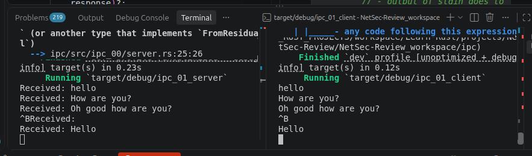
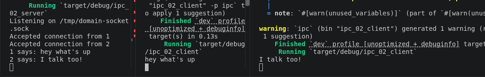

# Domain sockets aka IPC (Inter-Process Communication) crate

## most related crate/API

- [Unix Stream](https://doc.rust-lang.org/std/os/unix/net/struct.UnixStream.html)
- [Unix Listener](https://doc.rust-lang.org/std/os/unix/net/struct.UnixListener.html)
- [UnixDatagram](https://doc.rust-lang.org/std/os/unix/net/struct.UnixDatagram.html) - More like UDP domain socket

## Demo Example Options (spitballing)

- [ ] bidirectional user typing back and forth - using threads for listening and typing asynchronously
- [ ] Parse different commands for transmitting different data types
- [ ] Add encryption to the messages (big on for my other project)
- [ ] Get more information about the connection and process
- [ ] Do more with connection control - currently drops when one client shuts down
- [ ] Should do some examples with UnixDatagram instead of stream.
- [ ] Add authenication would be good.
- We'll do a proper log of connection history.

### More unified example

To more test a real world scenario:

- Setup up a service to run in background with special permissions (for some reason)
  - ## Then have limited permission app (maybe user gui) send requests.
-
---
---
## Example 1 - Basic communication

- This is just example of basic 2 way communication.
- The client connects to the server
  - The client transmits a message
  - The server receives that message
    - prints that massage and replies
  - The client receives servers message, prints, and shutdown

### Source / Outcome

| Role   | Library                                    | Binary                                         |
| ------ | ------------------------------------------ | ---------------------------------------------- |
| Client | [ipc_00/client.rs](./src/ipc_00/client.rs) | [ipc_00_client.rs](./src/bin/ipc_00_client.rs) |
| Server | [ipc_00/server.rs](./src/ipc_00/server.rs) | [ipc_00_server.rs](./src/bin/ipc_00_server.rs) |

---
---

## Example 2 - Basic Looped IPC User Messenger

This time I'm going model it after ch02 of the Rust Language Book (guessing game), except without the guessing. Effectively i want a little message loop where user as client can keep typing messages and server will print it out - and program doesn't quit until canceled ctl+C

1. Server: Add a loop, checking, and printing out messages received
2. Client: Maintains connection (don't worry about reading from server)
   - and asks for user input on loop to send to server.

### Source / Outcome

| Role   | Library                                    | Binary                                         |
| ------ | ------------------------------------------ | ---------------------------------------------- |
| Client | [ipc_01/client.rs](./src/ipc_01/client.rs) | [ipc_01_client.rs](./src/bin/ipc_01_client.rs) |
| Server | [ipc_01/server.rs](./src/ipc_01/server.rs) | [ipc_01_server.rs](./src/bin/ipc_01_server.rs) |

---
---

## Example 3 - More clients and connection information

### Retrospective - (I like this part because it's just me whining and ranting)

- Example 2 works - but it's one way - client to server.
- Also it only works with 1 client
- Also it doesn't indicate any connect information - either to log or terminal

### Prospective

Let's change those things!

- Let's start with getting more connection data
    - Or IDing connections
- Have both clients talk to the server at the same time
- We'll indicate who's talking via the terminal

#### API Review: 

To get as much connection information as possible - let's review the API:
- [Unix Stream](https://doc.rust-lang.org/std/os/unix/net/struct.UnixStream.html)
- [Unix Listener](https://doc.rust-lang.org/std/os/unix/net/struct.UnixListener.html)

##### Notes
- UnixListener methods: accept, incoming, local_addr, set_nonblocking, take_error, try_clone
- Example 2 was just not managing new connections in new threads
    - looping through listener.incoming() and spawning new threads for each client is way to go.
    - struct 'incoming' impliments traits: 
        - Debug, Iterator, (auto-traits: Freeze, RefUnwindSafe, Send, Sync, Unpin, UnsafeUnpin, UnwindSafe)

### Source / Outcome 

| Role   | Library                                    | Binary                                         |
| ------ | ------------------------------------------ | ---------------------------------------------- |
| Client | [ipc_02/client.rs](./src/ipc_02/client.rs) | [ipc_02_client.rs](./src/bin/ipc_02_client.rs) |
| Server | [ipc_02/server.rs](./src/ipc_02/server.rs) | [ipc_02_server.rs](./src/bin/ipc_02_server.rs) |

