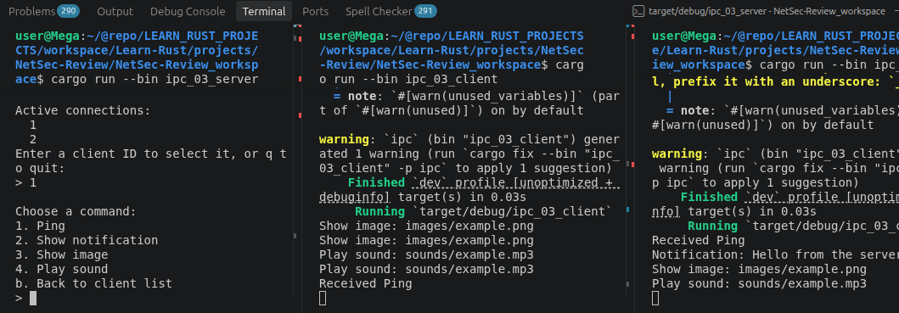

# Domain sockets aka IPC (Inter-Process Communication) crate

## most related crate/API

- [Unix Stream](https://doc.rust-lang.org/std/os/unix/net/struct.UnixStream.html)
- [Unix Listener](https://doc.rust-lang.org/std/os/unix/net/struct.UnixListener.html)
- [UnixDatagram](https://doc.rust-lang.org/std/os/unix/net/struct.UnixDatagram.html) - More like UDP domain socket

## Demo Example Options (spitballing)

- [x] bidirectional communication back and forth
  - (did unidirectional - but user prompts are played out)
- [x] handle multiple clients (initial)
- [ ] Parse different commands for transmitting different data types
- [ ] Add encryption to the messages (matters less for IPC)
- [ ] Get more information about the connection and process
  - This doesn't matter for IPC - with use Auth instead
- [ ] Robust connection control
  - currently drops when one client shuts down
- [ ] Should do some examples with UnixDatagram instead of stream.
- [ ] Add authentication
- [ ] Logging of connection history.

### More unified example

To more test a real world scenario:
- [ ] Setup up a service to run in background with special permissions (for some reason)
  - Then have limited permission app (maybe user gui) send requests.
- [ ] Setup a command and control scenario

- ***
  ***

## Example 1 - Basic communication

- This is just example of basic 2 way communication.
- The client connects to the server
  - The client transmits a message
  - The server receives that message
    - prints that massage and replies
  - The client receives servers message, prints, and shutdown

### Source / Outcome

| Role   | Library                                    | Binary                                         |
| ------ | ------------------------------------------ | ---------------------------------------------- |
| Client | [ipc_00/client.rs](./src/ipc_00/client.rs) | [ipc_00_client.rs](./src/bin/ipc_00_client.rs) |
| Server | [ipc_00/server.rs](./src/ipc_00/server.rs) | [ipc_00_server.rs](./src/bin/ipc_00_server.rs) |

---

---

## Example 2 - Basic Looped IPC User Messenger

This time I'm going model it after ch02 of the Rust Language Book (guessing game), except without the guessing. Effectively i want a little message loop where user as client can keep typing messages and server will print it out - and program doesn't quit until canceled ctl+C

1. Server: Add a loop, checking, and printing out messages received
2. Client: Maintains connection (don't worry about reading from server)
   - and asks for user input on loop to send to server.

### Source / Outcome

Rust language feature used: **IO (input)**

| Role   | Library                                    | Binary                                         |
| ------ | ------------------------------------------ | ---------------------------------------------- |
| Client | [ipc_01/client.rs](./src/ipc_01/client.rs) | [ipc_01_client.rs](./src/bin/ipc_01_client.rs) |
| Server | [ipc_01/server.rs](./src/ipc_01/server.rs) | [ipc_01_server.rs](./src/bin/ipc_01_server.rs) |

---

<table cellpadding="0" cellspacing="0"  bgcolor="#090909"   border="1"
  frame="box"   rules="none">
  <tr>
    <td width="66" valign="middle">
      
    </td>
    <td>
   <strong>
    One thing that is a little tricky here is that i don't   want to add too much or too little in each iteration...
    </strong> 
    </td>
  </tr>
</table>

---

## Example 3 - More clients and connection information

- Let's start with getting more connection data
  - (actually, for ipc, the stream itself can't access its own process information other than by reading it from /proc or using OS calls.)
  - So I'ved added a static variable for just handling connections - DONE
- Have multiple clients talk to the server at the same time - DONE
- We'll indicate who's talking via the terminal - DONE

#### API Study/Review:

Let's review the API:

- [Unix Stream](https://doc.rust-lang.org/std/os/unix/net/struct.UnixStream.html)
- [Unix Listener](https://doc.rust-lang.org/std/os/unix/net/struct.UnixListener.html)

##### Notes

- UnixListener methods: accept, incoming, local_addr, set_nonblocking, take_error, try_clone
- Example 2 was just not managing new connections in new threads
  - looping through listener.incoming() and spawning new threads for each client is way to go.
  - struct 'incoming' implements traits:
    - Debug, Iterator, (auto-traits: Freeze, RefUnwindSafe, Send, Sync, Unpin, UnsafeUnpin, UnwindSafe)

### Source / Outcome

Rust language feature used: **static variable counting**, **threads**

| Role   | Library                                    | Binary                                         |
| ------ | ------------------------------------------ | ---------------------------------------------- |
| Client | [ipc_02/client.rs](./src/ipc_02/client.rs) | [ipc_02_client.rs](./src/bin/ipc_02_client.rs) |
| Server | [ipc_02/server.rs](./src/ipc_02/server.rs) | [ipc_02_server.rs](./src/bin/ipc_02_server.rs) |

---

---

## Example 4 - Basic IPC command selection template

Messages are great - but you ain't a queen B unless you directing the workers. 🐝

- Add server command options (will use enum and match)
- Clients will respond to the server command and do something - and report back.
- I'm also going to rework the core application a bit more to handle

#### API Study/Review:

- [Serde](https://serde.rs/) - Serial/Deserializer.

### Source / Outcome

Ok. So build this out more on server and client side. Server has effectively a double nested menu - where you can select from active connections which that you'd like to interactive with (is displayed as the IDs), then select which of the unified enum options from the com_proc.rs file: ping, show notification, show image, play sound. On Server: In order be listening for connections while I await keyboard commands I throw the connection listener.incoming() in it's own thread and use mpsc to transfer data between threads (aka that thread and the main thread). Both client and server files use the same enum definitions from comp_proc.rs, and commands are serialized/deserialized with serde_json::{to_string, from_str} commands respectively.

Rust language feature used:

- **enum states matching**,
- **mpsc (multi-producer, single-consumer) thread communication**
- **Serialization / Deserialization with Serde/Serde_json crate**
- **hashmap usage**

| Role   | Library                                    | Binary                                         |
| ------ | ------------------------------------------ | ---------------------------------------------- |
| Client | [ipc_03/client.rs](./src/ipc_03/client.rs) | [ipc_03_client.rs](./src/bin/ipc_03_client.rs) |
| Server | [ipc_03/server.rs](./src/ipc_03/server.rs) | [ipc_03_server.rs](./src/bin/ipc_03_server.rs) |

- Also added [ipc_03/com_proc](./src/ipc_03/client.rs) to support the unified data protocol.
- Also added `serde = { version = "1.0", features = ["derive"] }` to toml

*Server (left) - sending individual commands to both clients (switching back and forth)*

---
---

## Next option: authentication, encryption
- Also - i want the clients to be more robust - aka they should not shutdown when the server process dies - but occasionally attempt reconnection.
- The server can command process shutdown however.
- Detect dropped clients