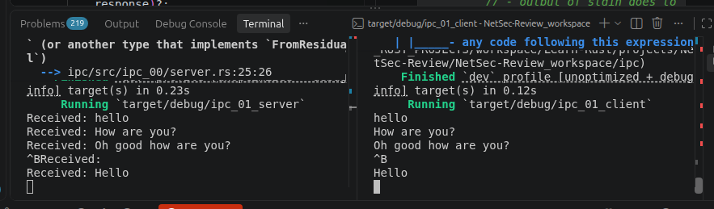
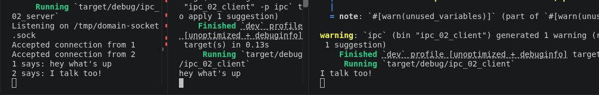
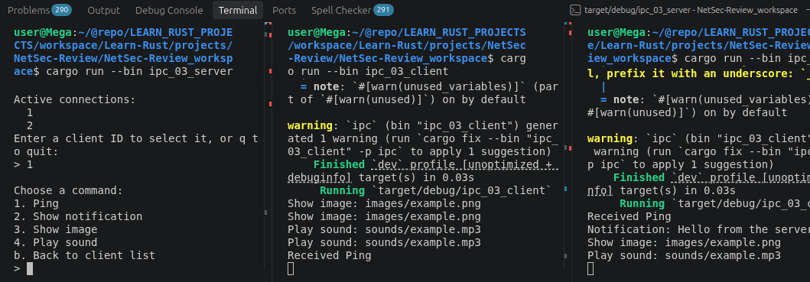
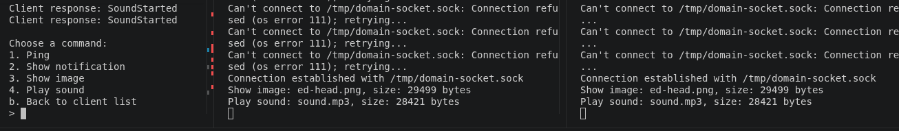
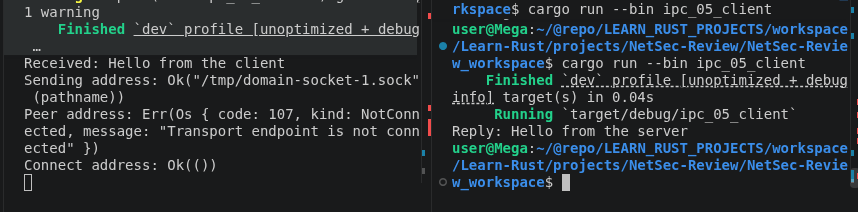
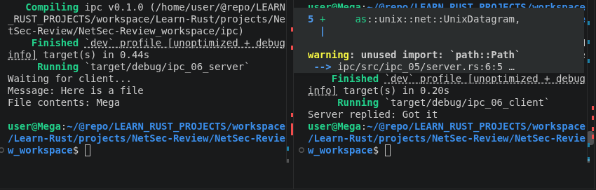

# Domain sockets aka IPC (Inter-Process Communication) crate

## most related crate/API

- [Unix Stream](https://doc.rust-lang.org/std/os/unix/net/struct.UnixStream.html)
- [Unix Listener](https://doc.rust-lang.org/std/os/unix/net/struct.UnixListener.html)
- [UnixDatagram](https://doc.rust-lang.org/std/os/unix/net/struct.UnixDatagram.html) - More like UDP domain socket\
- [uds (Crate)] - Unix domain sockets] (https://docs.rs/uds/latest/uds/)
  - includes fd-passing
  - SOCK_SEQPACKET option

## Demo ideas list

See [Appendix Eh](#appendix-eh) for more information

---

---

## Example 1 - Basic communication

- This is just example of basic 2 way communication.
- The client connects to the server
  - The client transmits a message
  - The server receives that message
    - prints that massage and replies
  - The client receives servers message and prints

### Source / Outcome

| Role   | Library                                    | Binary                                         |
| ------ | ------------------------------------------ | ---------------------------------------------- |
| Client | [ipc_00/client.rs](./src/ipc_00/client.rs) | [ipc_00_client.rs](./src/bin/ipc_00_client.rs) |
| Server | [ipc_00/server.rs](./src/ipc_00/server.rs) | [ipc_00_server.rs](./src/bin/ipc_00_server.rs) |

---

---

## Example 2 - Basic Looped IPC User Messenger

This time I'm going model it after ch02 of the Rust Language Book (guessing game), except without the guessing game part. Effectively i want a little message loop where user as client can keep typing messages and server will print it out - and program doesn't quit until canceled ctl+C

1. Server: Add a loop, checking, and printing out messages received

- Uses newline limiter

2. Client: Maintains connection (don't worry about reading from server)
   - and asks for user input on loop to send to server.

### Source / Outcome

Rust language feature used: **IO (input)**

| Role   | Library                                    | Binary                                         |
| ------ | ------------------------------------------ | ---------------------------------------------- |
| Client | [ipc_01/client.rs](./src/ipc_01/client.rs) | [ipc_01_client.rs](./src/bin/ipc_01_client.rs) |
| Server | [ipc_01/server.rs](./src/ipc_01/server.rs) | [ipc_01_server.rs](./src/bin/ipc_01_server.rs) |

---

<table cellpadding="0" cellspacing="0"  bgcolor="#090909"   border="1"
  frame="box"   rules="none">
  <tr>
    <td width="66" valign="middle">
      
    </td>
    <td>
   <strong>
    One thing that is a little tricky here is that i don't   want to add too much or too little in each iteration...
    </strong> 
    </td>
  </tr>
</table>

---

## Example 3 - Manage more clients and and store connection information

- Let's start with getting more connection data
  - I've added atomic static variable for just handling connections.
- Have multiple clients talk to the server at the same time
- Indicate who's talking via the terminal

#### API Study/Review:

Let's review the API:

- [Unix Stream](https://doc.rust-lang.org/std/os/unix/net/struct.UnixStream.html)
- [Unix Listener](https://doc.rust-lang.org/std/os/unix/net/struct.UnixListener.html)

<!-- ##### Notes

- UnixListener methods: accept, incoming, local_addr, set_nonblocking, take_error, try_clone
- Example 2 was just not managing new connections in new threads
  - looping through listener.incoming() and spawning new threads for each client is way to go.
  - struct 'incoming' implements traits:
    - Debug, Iterator, (auto-traits: Freeze, RefUnwindSafe, Send, Sync, Unpin, UnsafeUnpin, UnwindSafe) -->

### Source / Outcome

Rust language feature used: **static variable counting**, **threads**

| Role   | Library                                    | Binary                                         |
| ------ | ------------------------------------------ | ---------------------------------------------- |
| Client | [ipc_02/client.rs](./src/ipc_02/client.rs) | [ipc_02_client.rs](./src/bin/ipc_02_client.rs) |
| Server | [ipc_02/server.rs](./src/ipc_02/server.rs) | [ipc_02_server.rs](./src/bin/ipc_02_server.rs) |

---

---

## Example 4 - Basic full-bodied IPC command selection

Messages are great - but you ain't a queen B unless you directing the workers. 🐝

- Add server command options (will use enum and match)
- Clients will respond to the server command and do something - and report back.
  - Stored as hashmap
- I'm also going to rework the core application a bit more to handle

#### Implementation Notes

- Server now has a double nested menu
  - you can select from printed active connections
    - then select which of the unified enum options from the com_proc.rs file:
      - ping, show notification, show image, play sound.
  - In order be listening for connections while I await keyboard commands I throw the connection listener.incoming() in it's own thread and use mpsc to transfer data between new thread and main thread
  - Both client and server files use the same enum definitions from comp_proc.rs, and commands are serialized/deserialized with serde_json::{to_string, from_str} commands respectively.

#### API Study/Review:

- [Serde](https://serde.rs/) - Serial/Deserializer.

### Rust language feature used:

- **enum states matching**,
- **mpsc (multi-producer, single-consumer) thread communication**
- **Serialization / Deserialization with Serde/Serde_json crate**
- **hashmap usage**

### Source / Outcome

| Role     | Library                                    | Binary                                         | Description                                |
| -------- | ------------------------------------------ | ---------------------------------------------- | ------------------------------------------ |
| Client   | [ipc_03/client.rs](./src/ipc_03/client.rs) | [ipc_03_client.rs](./src/bin/ipc_03_client.rs) |                                            |
| Server   | [ipc_03/server.rs](./src/ipc_03/server.rs) | [ipc_03_server.rs](./src/bin/ipc_03_server.rs) |                                            |
| Com proc | [ipc_03/com_proc](./src/ipc_03/client.rs)  |                                                | Unified Communication Protocol action bank |

- Also added `serde = { version = "1.0", features = ["derive"] }` to toml

_Server (left) - sending individual commands to both clients (switching back and forth)_

---

## Side Bar

<table cellpadding="0" cellspacing="0"  bgcolor="#090909"   border="1"
  frame="box"   rules="none">
  <tr>
    <td width="66" valign="middle">
      
    </td>
    <td>
   <strong>
Ok - after much ruminating on what to do next (and brainstorming a bunch of potential demos of IPC that didn't hit the mark for real use-case examples), I started developing a the real-use case I have for the whimsical final goal of this NetSec-Review venture - which I've now formalized here in a major project for this project:
    </strong> 
    </td>
  </tr>
</table>

- [Major Project 1 - Keyboard Commander](./Major-Project-01_1-hand-keyboard-System.md)
- See [MP1 - Keyboard Commander - Feature 1](../../Major-Project-01_one-hand-keyboard-System.md#feature-1---full-remote-keyboard-control) for my real world use case of an root-only service being interacted with by client interface for security and encapsulation reasons. (It's effectively a keylogger that will transmit when mode selected to act as remote keyboard - Danger Zone!)

---

## Example 5 - Robust connection handling, multicast, varied data-transfer, UnixDatagram addon

<table cellpadding="0" cellspacing="0"  bgcolor="#090909"   border="1"
  frame="box"   rules="none">
  <tr>
    <td width="66" valign="middle">
      
    </td>
    <td>
   <strong>
Most program complete example
    </strong> 
    </td>
  </tr>
</table>

I want example 5 (04) to have a complete base copy for reworking later for the final project.

Next steps:

- Add robustness to the clients (mixture of error handling )
  - Prevent fail on disconnect and instead search for reconnection periodically
    - Adjusted handler to remove client connections
- Add option for sending the same data to all clients at the same time and implement logic. (multi-cast)
- Implement actual data transfers using Rust style idiomatic enum Option management capabilities
  - Such that 'show image' transfers the image, same with sound (mp3)
  - (I still don't care too much about having real world data or linux control - for this with IPC)

#### Implementation Notes

- Client: Reworked this into 4 functions that separate concerns, and all the system to loop in phases. If connection breaks, it falls back to connect loop, checking for server every 5 seconds
- Server: Added error checking for connection to prevent shutdown on accessing downed client
  - Also refactored full thing, added another thread to handle input (and another mpsc). Separated the 2 phases of menu, client selection, and data transfer selection.
- For all 3 lib files - adjusted so we're passing files with Vec<u8> data rather than just strings.

### New Rust API/Crates

- Used proper Option enum (Rusts version of memory safe null)

### Source / Outcome

| Role     | Library                                     | Binary                                         | Description                                |
| -------- | ------------------------------------------- | ---------------------------------------------- | ------------------------------------------ |
| Client   | [ipc_04/client.rs](./src/ipc_04/client.rs)  | [ipc_04_client.rs](./src/bin/ipc_04_client.rs) |                                            |
| Server   | [ipc_04/server.rs](./src/ipc_04/server.rs)  | [ipc_04_server.rs](./src/bin/ipc_04_server.rs) |                                            |
| Com proc | [ipc_04/com_proc](./src/ipc_04/com_proc.rs) |                                                | Unified Communication Protocol action bank |

_Server (left) - sending data packets commands to both clients (multicast)_

_Also shows clients auto reconnecting on failure every 5 seconds_

## Example 6 - Simple UnixDatagram

- Utilize UnixDatagram (connection-less UDP style socket)
  - Just for posterity example

### Implementation Notes

- I create bi-directional communication by using 2 socket files but they're one-way each.

### Notes

- You can bind to a specific recv addr or use unbounded() to recv from any.
  - This would be restricted through file permission system only.
- There are some recv_vectored options for data + ancillary data

### New Rust API/Crates

- [UnixDatagram](https://doc.rust-lang.org/std/os/unix/net/struct.UnixDatagram.html)
  - Unix Datagrams are also reliable and ordered (unlike UDP)
  - Bonus: send() is bounded, so you don't have to parse messages from byte stream
  - It's uni-directional 1-to-many, or 1-to-1.
    - Use-case: E.g. If server is sending to a less privileged client. (no revolving door, like multiprocessor observer)
  - "one send = one message"

| Role   | Library                                    | Binary                                         |
| ------ | ------------------------------------------ | ---------------------------------------------- |
| Client | [ipc_05/client.rs](./src/ipc_05/client.rs) | [ipc_05_client.rs](./src/bin/ipc_05_client.rs) |
| Server | [ipc_05/server.rs](./src/ipc_05/server.rs) | [ipc_05_server.rs](./src/bin/ipc_05_server.rs) |

_Very simple example using UnixDatagram - datapass and shutdown - ignore peer message_

## Example 7 - Crate uds (UnixDomainSockets)

- one example with SOCK_SEQPACKET
- One example of abstract addresses (Linux Specific)
  - I just learned about this one from the module - so let's try!
- One example of fd-passing (my favorite)

### Implementation Notes

- Ok - so obviously fd (file descriptors) are process specific in the process descriptor table - what we're doing though - is passing the resource, not just the number (as though it would mean anything) which creates new fd in the receiving processes fd table.
  - The receiving process makes it's own fd entry - but the point is we can say outsource some work on a resource that is owned by another process (or user).
- Note: The primary use cases for doing fd-passing is to say pass a TCP connection to another process, or for supervisor process to pass one endpoint of a resource to a worker. (I may later do this in MP1 - for now program just indicates the fd is passed
  )

### Notes

- uds crate has support for abstract addresses, fd-passing, SOCK_SEQPACKET sockets
  - It effectively extends functionality of default unix sockets (and more)
  - SEQPACKET - preserves message boundaries and a connection, with reliable, ordered delivery.
    - UnixStream - reliable and ordered but is byte stream
    - UnixDatagram - preserves message boundaries - but connection-less
- "Everything-is-a-file" - my instructor lied!
  - Ok - abstract socket addresses are a Linux kernel feature allows setting a path with a prefixed null byte ('\0') Read unix man page for more info:
  - [unix man page for abstract socket](https://man7.org/linux/man-pages/man7/unix.7.html) - under abstract
    - also read security in-case there was relevant something but nothing special about abstract sockets

### Rust language feature used:

- first use of **_'unsafe'_** rust code.

### New Rust API/Crates

- [Crate uds](https://docs.rs/uds/latest/uds/)
  - [UnixStreamExt (Trait)](https://docs.rs/uds/latest/uds/trait.UnixStreamExt.html)
  - [UnixListenerExt (Trait)](https://docs.rs/uds/latest/uds/trait.UnixListenerExt.html)
  - [UnixDatagram (Trait)](https://docs.rs/uds/latest/uds/trait.UnixDatagramExt.html)
  - uses Tokio library for nonblocking

### Source / Outcome

| Role   | Library                                    | Binary                                         |
| ------ | ------------------------------------------ | ---------------------------------------------- |
| Client | [ipc_06/client.rs](./src/ipc_06/client.rs) | [ipc_06_client.rs](./src/bin/ipc_06_client.rs) |
| Server | [ipc_06/server.rs](./src/ipc_06/server.rs) | [ipc_06_server.rs](./src/bin/ipc_06_server.rs) |

_Shows using abstract socket address, SOCK_SEQPACKET, and fd passing, receiver reads from /etc/host_
<!--
Let's split commands up into recon and implementation using my existing commands

1. When studying bluetoothctl recently - i messed around sending audio files directly to bluetooth headsets

- RECON: query the system for audio devices and return that data to server program
- ATTACK: Play an mp3 - to selected audio device.

2. Display an image on screen

- RECON: Let's query for current displays
- ATTACK: display full page hacker ed image onscreen

3. Send message to system terminal

- RECON: QUERY FOR OPEN TERMINALS
- ATTACK: send a message to a chosen terminal (or all)

4. Ping - jk - let's do maybe a recon suite

- RECON: get whoami, memory, partician table etc.
- ATTACK: DoS (jk) -->

---

---

## Appendix A

These were eating up too much space at top

### Next option: authentication, encryption

- Also - i want the clients to be more robust - aka they should not shutdown when the server process dies - but occasionally attempt reconnection.
- The server can command process shutdown however.
- Detect dropped clients

### tasks to cover

- [x] bidirectional communication back and forth
  - (did unidirectional - but user prompts are played out)
- [x] handle multiple clients (initial)
- [x] Parse different commands for transmitting different data types
  - This doesn't matter for IPC - with use Auth instead
- [x] Robust connection control
  - currently drops when one client shuts down
- [x] Should do some examples with UnixDatagram instead of stream.
- [x] Cleanup and failure handling
- [x] Show example of SEQPACKET with uds library
- [x] Show example of fd passing (uds or UnixStream)

### More unified example

To more test a real world scenario:

- [MOVING_TO_MP1] Setup up a service to run in background with special permissions (for some reason)
  - Then have limited permission app (maybe user gui) send requests.
- [x] Setup a command and control scenario

### Brainstorm - what use cases are IPC connections best for

- Ok - I don't think i care after all about implementing the function here without a good reason.

A good reason: Let's setup a monitoring app with 2 components

- A server application with advanced permissions
- A client application with limited permission

A privileged administrator service may want to monitor:

- (users, specific logs)
- Let's go with user. (make this fun with pts control as well)

Scenario A: A multi-user system allows remote connection by various users. When that user logs into terminal the root service detects this an opens terminal window on each users screen to alert the system - and has option to open up a terminal based chat server between users.

- A desktop app talks to a background service. (most obvious one)
- A loser process needs to request something from a privileged process
  - Permissions test: Create the socket in a private directory, then see which users can connect. Socket filesystem permissions help control access.
- Writing a system wide logging service for my own applications as a daemon - then all clients
- The one ring rules them all!!
  - Make a variety of different clients with different purposes but that share a shelled management command interface (pause, reload, rename)
  - Even cooler - make the server be able to pass off command to a client hot-swap.
  - Client options: (logging, proc observation, select file watching, security bot, unified desktop/terminal notification system, etc)
- So actually i was wrong - while passing a fd is meaningless because its process specific you can pass open resources with Unix Domain Sockets using SCM_RIGHTS - the kernel installs new descriptor
  - oh i guess this is similar to pipes.
- cooperative game communication - 2 apps running in separate windows.
- Proxy port access - (is a good one)
  - Can setup a service on a port that manages traffic like an additional layer of custom firewall

### Research areas to investigate while i sort out avenues

- Linux logging system
  - If i build a logging client with ipc
- VFS - Virtual FileSystems
- Linux file permission
  - IPC testing
- tty (text-terminal connection) management
  - `tty` command returns current terminal
    - e.g. `/dev/pts/11`
    - echo "Hello in the other window" > /dev/pts/11
    - Watch terminal registered `watch -n 2 'ls /dev/pts'`
    - `ps -u "$USER" -o pid,tty,comm` useful
- Check users
  - `loginctl`
    - user-status, list-session, etc
    - list-session gives you session id
      - loginctl show-session SESSION_ID -p Name -p Type -p Remote -p Seat -p TTY
      - Type: (X11, wayland, tty(for headless))
- display
