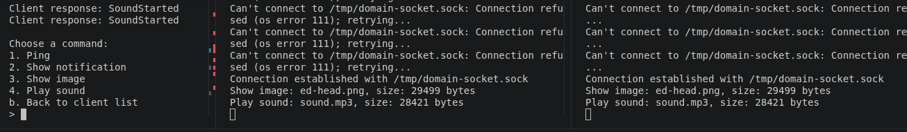

# Domain sockets aka IPC (Inter-Process Communication) crate

## most related crate/API

- [Unix Stream](https://doc.rust-lang.org/std/os/unix/net/struct.UnixStream.html)
- [Unix Listener](https://doc.rust-lang.org/std/os/unix/net/struct.UnixListener.html)
- [UnixDatagram](https://doc.rust-lang.org/std/os/unix/net/struct.UnixDatagram.html) - More like UDP domain socket\
- [uds (Crate)] - Unix domain sockets] (https://docs.rs/uds/latest/uds/)
  - includes fd-passing
  - SOCK_SEQPACKET option

## Demo ideas list

See [Appendix Eh](#appendix-eh---some-more-brainstorming) for more information

---

---

## Example 1 - Basic communication

- This is just example of basic 2 way communication.
- The client connects to the server
  - The client transmits a message
  - The server receives that message
    - prints that massage and replies
  - The client receives servers message, prints, and shutdown

### Source / Outcome

| Role   | Library                                    | Binary                                         |
| ------ | ------------------------------------------ | ---------------------------------------------- |
| Client | [ipc_00/client.rs](./src/ipc_00/client.rs) | [ipc_00_client.rs](./src/bin/ipc_00_client.rs) |
| Server | [ipc_00/server.rs](./src/ipc_00/server.rs) | [ipc_00_server.rs](./src/bin/ipc_00_server.rs) |

---

---

## Example 2 - Basic Looped IPC User Messenger

This time I'm going model it after ch02 of the Rust Language Book (guessing game), except without the guessing. Effectively i want a little message loop where user as client can keep typing messages and server will print it out - and program doesn't quit until canceled ctl+C

1. Server: Add a loop, checking, and printing out messages received
2. Client: Maintains connection (don't worry about reading from server)
   - and asks for user input on loop to send to server.

### Source / Outcome

Rust language feature used: **IO (input)**

| Role   | Library                                    | Binary                                         |
| ------ | ------------------------------------------ | ---------------------------------------------- |
| Client | [ipc_01/client.rs](./src/ipc_01/client.rs) | [ipc_01_client.rs](./src/bin/ipc_01_client.rs) |
| Server | [ipc_01/server.rs](./src/ipc_01/server.rs) | [ipc_01_server.rs](./src/bin/ipc_01_server.rs) |

---

<table cellpadding="0" cellspacing="0"  bgcolor="#090909"   border="1"
  frame="box"   rules="none">
  <tr>
    <td width="66" valign="middle">
      
    </td>
    <td>
   <strong>
    One thing that is a little tricky here is that i don't   want to add too much or too little in each iteration...
    </strong> 
    </td>
  </tr>
</table>

---

## Example 3 - More clients and connection information

- Let's start with getting more connection data
  - (actually, for ipc, the stream itself can't access its own process information other than by reading it from /proc or using OS calls.)
  - So I'ved added a static variable for just handling connections - DONE
- Have multiple clients talk to the server at the same time - DONE
- We'll indicate who's talking via the terminal - DONE

#### API Study/Review:

Let's review the API:

- [Unix Stream](https://doc.rust-lang.org/std/os/unix/net/struct.UnixStream.html)
- [Unix Listener](https://doc.rust-lang.org/std/os/unix/net/struct.UnixListener.html)

##### Notes

- UnixListener methods: accept, incoming, local_addr, set_nonblocking, take_error, try_clone
- Example 2 was just not managing new connections in new threads
  - looping through listener.incoming() and spawning new threads for each client is way to go.
  - struct 'incoming' implements traits:
    - Debug, Iterator, (auto-traits: Freeze, RefUnwindSafe, Send, Sync, Unpin, UnsafeUnpin, UnwindSafe)

### Source / Outcome

Rust language feature used: **static variable counting**, **threads**

| Role   | Library                                    | Binary                                         |
| ------ | ------------------------------------------ | ---------------------------------------------- |
| Client | [ipc_02/client.rs](./src/ipc_02/client.rs) | [ipc_02_client.rs](./src/bin/ipc_02_client.rs) |
| Server | [ipc_02/server.rs](./src/ipc_02/server.rs) | [ipc_02_server.rs](./src/bin/ipc_02_server.rs) |

---

---

## Example 4 - Basic IPC command selection template

Messages are great - but you ain't a queen B unless you directing the workers. 🐝

- Add server command options (will use enum and match)
- Clients will respond to the server command and do something - and report back.
- I'm also going to rework the core application a bit more to handle

#### API Study/Review:

- [Serde](https://serde.rs/) - Serial/Deserializer.

### Source / Outcome

Ok. So build this out more on server and client side. Server has effectively a double nested menu - where you can select from active connections which that you'd like to interactive with (is displayed as the IDs), then select which of the unified enum options from the com_proc.rs file: ping, show notification, show image, play sound. On Server: In order be listening for connections while I await keyboard commands I throw the connection listener.incoming() in it's own thread and use mpsc to transfer data between threads (aka that thread and the main thread). Both client and server files use the same enum definitions from comp_proc.rs, and commands are serialized/deserialized with serde_json::{to_string, from_str} commands respectively.

Rust language feature used:

- **enum states matching**,
- **mpsc (multi-producer, single-consumer) thread communication**
- **Serialization / Deserialization with Serde/Serde_json crate**
- **hashmap usage**

| Role     | Library                                    | Binary                                         | Description                                |
| -------- | ------------------------------------------ | ---------------------------------------------- | ------------------------------------------ |
| Client   | [ipc_03/client.rs](./src/ipc_03/client.rs) | [ipc_03_client.rs](./src/bin/ipc_03_client.rs) |                                            |
| Server   | [ipc_03/server.rs](./src/ipc_03/server.rs) | [ipc_03_server.rs](./src/bin/ipc_03_server.rs) |                                            |
| Com proc | [ipc_03/com_proc](./src/ipc_03/client.rs)  |                                                | Unified Communication Protocol action bank |

- Also added `serde = { version = "1.0", features = ["derive"] }` to toml

_Server (left) - sending individual commands to both clients (switching back and forth)_

---

## Side Bar

Ok - after much ruminating on what to do next (and brainstorming a bunch of potential demos of IPC that didn't hit the mark for real use-case examples), I started developing a the real-use case I have for the whimsical final goal of this NetSec-Review venture - which I've now formalized here in a major project for this project:

- [Major Project 1 - Keyboard Commander](./Major-Project-01_1-hand-keyboard-System.md)
- See [MP1 - Keyboard Commander - Feature 1](../../Major-Project-01_one-hand-keyboard-System.md#feature-1---full-remote-keyboard-control) for my real world use case of an root-only service being interacted with by client interface for security and encapsulation reasons. I'm effectively key-logging myself.

Note: I still want to continue some examples for IPC - but mostly around creating a robust connection - rather than working on more trivial aspects like (encryption, authentication, etc) - that I will push forward to work into TCP examples (where they're more relevant anyway)

---

## Example 5 - Robust connection handling, multicast, varied data-transfer, UnixDatagram addon

I want example 5 (04) to have a complete base copy for reworking later for the final project.

Next steps:

- Add robustness to the clients (mixture of error handling )
  - [x] I want then to not fail on disconnect but instead search for reconnection periodically
  - ~~tI want to add on-shutdown style code to notify rather than resume connection is live until data transfer attempt~~t
    - [x] This i justed handled with logical removing of client connections when attempting multi-cast
- [x] I want to also have an option for sending the same data to all clients at the same time. (multi-cast)
- [x] I want to include data transfers building on Rusts enum data management capabilities
  - Such that 'show image' transfers the image, same with sound (mp3)
  - (I still don't care too much about having real world data or linux control - for this with IPC)

#### Implementation Notes

- Client: Reworked this into 4 functions that separate concerns, and all the system to loop in phases. If connection breaks, it falls back to connect loop, checking for server every 5 seconds
- Server: Added error checking for connection to prevent shutdown on accessing downed client
  - Also refactored full thing, added another thread to handle input (and another mpsc). Separated the 2 phases of menu, client selection, and data transfer selection.
- For all 3 lib files - adjusted so we're passing files with Vec<u8> data rather than just strings.

### New Rust API/Crates

Actually none in this case - full robustness though.

### Source links

| Role     | Library                                    | Binary                                         | Description                                |
| -------- | ------------------------------------------ | ---------------------------------------------- | ------------------------------------------ |
| Client   | [ipc_04/client.rs](./src/ipc_04/client.rs) | [ipc_04_client.rs](./src/bin/ipc_04_client.rs) |                                            |
| Server   | [ipc_04/server.rs](./src/ipc_04/server.rs) | [ipc_04_server.rs](./src/bin/ipc_04_server.rs) |                                            |
| Com proc | [ipc_04/com_proc](./src/ipc_04/com_proc.rs)   |                                                | Unified Communication Protocol action bank |

### Outcome

_Server (left) - sending data packets commands to both clients (multicast)_

_Also shows clients auto reconnecting on failure every 5 seconds_

## Example 6 - Into example of UnixDatagram

- Let's do one option to utilize UnixDatagram (UDP style socket) on the side
- Let's see if we can work fd passing into this example also so I can cover all the items I have for now with domain sockets.

### New Rust API/Crates
- [UnixDatagram](https://doc.rust-lang.org/std/os/unix/net/struct.UnixDatagram.html)
  - Unix Datagrams are also reliable and ordered (unlike UDP)
  - Bonus: send() is bounded, so you don't have to parse messages from byte stream
  - It's uni-directional 1-to-many, or 1-to-1.
    - So security hardened from server perspective
      - E.g. If server is sending to a less privileged client. (no revolving door)
  - However socket buffers are finite, so sends can still fail under pressure.
    - So "one send = one message"

<!--
Let's split commands up into recon and implementation using my existing commands

1. When studying bluetoothctl recently - i messed around sending audio files directly to bluetooth headsets

- RECON: query the system for audio devices and return that data to server program
- ATTACK: Play an mp3 - to selected audio device.

2. Display an image on screen

- RECON: Let's query for current displays
- ATTACK: display full page hacker ed image onscreen

3. Send message to system terminal

- RECON: QUERY FOR OPEN TERMINALS
- ATTACK: send a message to a chosen terminal (or all)

4. Ping - jk - let's do maybe a recon suite

- RECON: get whoami, memory, partician table etc.
- ATTACK: DoS (jk) -->

---

---

## Appendix A - Some more brainstorming

These were eating up too much space at top

### Next option: authentication, encryption

- Also - i want the clients to be more robust - aka they should not shutdown when the server process dies - but occasionally attempt reconnection.
- The server can command process shutdown however.
- Detect dropped clients

### tasks to cover

- [x] bidirectional communication back and forth
  - (did unidirectional - but user prompts are played out)
- [x] handle multiple clients (initial)
- [DOING] Parse different commands for transmitting different data types
- [MOVING_TO_TCP] Add encryption to the messages (matters less for IPC)
- [MOVING_TO_TCP] Get more information about the connection and process
  - This doesn't matter for IPC - with use Auth instead
- [DOING] Robust connection control
  - currently drops when one client shuts down
- [DOING] Should do some examples with UnixDatagram instead of stream.
- [DOING] Add authentication
- [DOING] Logging of connection history.
- [DOING] Cleanup and failure handling
- [ ] Show example of SEQPACKET with uds library
- [ ] Show example of fd passing (uds or UnixStream)

### More unified example

To more test a real world scenario:

- [ ] Setup up a service to run in background with special permissions (for some reason)
  - Then have limited permission app (maybe user gui) send requests.
- [ ] Setup a command and control scenario\

### Brainstorm - what use cases are IPC connections best for

- Ok - I don't think i care after all about implementing the function here without a good reason.

A good reason: Let's setup a monitoring app with 2 components

- A server application with advanced permissions
- A client application with limited permission

A privileged administrator service may want to monitor:

- (users, specific logs)
- Let's go with user. (make this fun with pts control as well)

Scenario A: A multi-user system allows remote connection by various users. When that user logs into terminal the root service detects this an opens terminal window on each users screen to alert the system - and has option to open up a terminal based chat server between users.

- A desktop app talks to a background service. (most obvious one)
- A loser process needs to request something from a privileged process
  - Permissions test: Create the socket in a private directory, then see which users can connect. Socket filesystem permissions help control access.
- Writing a system wide logging service for my own applications as a daemon - then all clients
- The one ring rules them all!!
  - Make a variety of different clients with different purposes but that share a shelled management command interface (pause, reload, rename)
  - Even cooler - make the server be able to pass off command to a client hot-swap.
  - Client options: (logging, proc observation, select file watching, security bot, unified desktop/terminal notification system, etc)
- So actually i was wrong - while passing a fd is meaningless because its process specific you can pass open resources with Unix Domain Sockets using SCM_RIGHTS - the kernel installs new descriptor
  - oh i guess this is similar to pipes.
- cooperative game communication - 2 apps running in separate windows.
- Proxy port access - (is a good one)
  - Can setup a service on a port that manages traffic like an additional layer of custom firewall

### Research areas to investigate while i sort out avenues

- Linux logging system
  - If i build a logging client with ipc
- VFS - Virtual FileSystems
- Linux file permission
  - IPC testing
- tty (text-terminal connection) management
  - `tty` command returns current terminal
    - e.g. `/dev/pts/11`
    - echo "Hello in the other window" > /dev/pts/11
    - Watch terminal registered `watch -n 2 'ls /dev/pts'`
    - (could definitely troll someone you hacked or another user)
    - `ps -u "$USER" -o pid,tty,comm` useful
- Check users
  - `loginctl`
    - user-status, list-session, etc
    - list-session gives you session id
      - loginctl show-session SESSION_ID -p Name -p Type -p Remote -p Seat -p TTY
      - Type: (X11, wayland, tty(for headless))
- display
