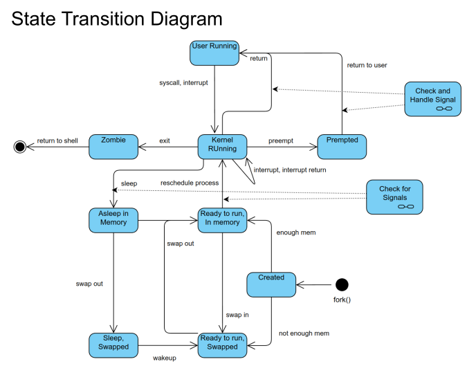

# My Review - COMP 7005 Computer Networks and Protocols

## Super Summary (or summary of stuff I'd like to deep dive again)

- Look up researching Validating, sanitizing, and normalizing paths with Rust (Im sure there's crates or standards)
- Reading this (particularly file descriptors section) makes me think it might be fun to try and mess around with trying to break file descriptor or open tables file - or at least reading these resources from a Rust application to see them visually.
- Looking at Rust fs api, looks like locks and shared locks are available for the same file access. (worth a deep dive when doing some fs work - to reread file descriptors section here )
- FYI - each processes file descriptor table is located in /proc/PID/fd/
- 'lsof' can be used to check system-wide file-handle counts

**Strategies for Securing UDP Traffic**

- Control the rate of traffic to prevent your server from being overwhelmed.
- Use intrusion detection systems (IDS) to identify abnormal traffic patterns and take appropriate action.
- Configure your firewall to block incoming UDP traffic from unknown sources or on unused ports.
- Though UDP does not provide encryption, developers can combine it with protocols like DTLS to ensure secure data transmission.
- Use more secure protocols for sensitive data transmission, like DNS over HTTPS (DoH) or DNS over TLS (DoT) for DNS queries.

## Comp7005 - Course Review

Ok - so this course was the first real specialty course for NetSec, where we built things, and also delved into actually programming network channels.

Again - I'm just reviewing my course materials without sharing it here - to review and get some ideas for programs to build with Rust.

This was also a much more detailed look into Linux operating systems, processes/services, and low level network communications. This will be much more relevant to using Rust.

[Art of Linux Programming](http://www.catb.org/esr/writings/taoup/html/)

<table cellpadding="0" cellspacing="0"  bgcolor="#090909"   border="1"
  frame="box"   rules="none">
  <tr>
    <td width="66" valign="middle">
      
    </td>
    <td>
   <strong>
  I'm basically going to skim all the documents from the course and just note anything that stands out (perhaps I forgot, or it might be relevant and i want to keep it top of mind for reference or could use some review, or worthy of looking at specifically within a Rust application).
    </strong>
    </td>
  </tr>
</table>

Topics:

### File System (Unix)

- Inode - data structure in Unix storing metadata about files/directories, excluding name and content
  - Has a unique inode number, size, ownership, timestamp, location of the data on storage
  - Using inodes allows the file system to access and manipulate files without searching the entire directory structure

Basically this is mostly just Linux basics, filesystems nd commands

- FUSE (Filesystem in Userspace):
  - FUSE enables users to create custom file systems without modifying the kernel.
  - FUSE-based file systems can be mounted by regular users, offering flexibility for various use cases.
- Virtual File Systems:
  - Virtual file systems provide interfaces to access system information or resources.
  - Examples include /proc (process information), /sys (kernel parameters), and /dev (device files).
- Previous Directory Shortcut (-)
  - forgot about this 'cd -"

### Path Manipulations

Path Normalization and Canonicalization

- Converting symbolic links into their ultimate target paths ensures the unique identification of every file and directory.
  - This might be relevant to some future app
- Converting relative paths to absolute paths, based on the current working directory, helps universal identification.

Validate User Input

- Basically checking user paths, usiing regex, and checking length limits, etc.

Path Traversal Attacks

- Path traversal attacks occur when attackers exploit insufficiently secured user input to navigate out of the intended directory, often to access restricted files.
  - Sanitizing:
  - Use an allowlist of acceptable inputs and block everything else.
  - Block or escape special characters like "..", "/", or "\" that can manipulate paths.
- Normalize and Sanitize Input
  - Use proper encoding techniques to handle special characters.
  - Transform paths to their simplest, standard form to prevent obfuscated attacks.

This is worth just researching Validating, sanitizing, and normalizing paths with Rust

### File Descriptors

Ok - now some good review stuff.

- Programs establish file descriptors when requiring file access; these descriptors are closed upon completion.
- Standard input, output, and error streams have corresponding file descriptors.
- Each program receives its own set of file descriptors, ensuring isolation and preventing interference.
- Proper closure of file descriptors is crucial to prevent resource leaks and ensure efficient resource utilization.

Process File Descriptor Table

- Each process maintains a unique file descriptor table, preventing sharing file descriptors between processes.
- It keeps track of the open file descriptors specific to that process and associated information, such as file status flags, file position, and I/O buffer pointers.
- This individual file descriptor table allows each process to maintain its state and modify its file descriptors independently.

Operating System Open File Table

- The operating system maintains the open file table.
- The open file table is a system-wide data structure managed by the operating system.
- Each entry in the open file table represents an open file or I/O resource, regardless of which process has opened it.
- Entries in the open file table store metadata such as file status flags, current file position, and other relevant details.

File Descriptors and Open File Table

- The process's file descriptor table references the open file table
- When a process opens a file, the operating system creates an entry in the open file table representing the opened file.
- The file descriptor acts as an index or handle to access the associated entry in the open file table.

File Descriptors and Process Isolation

- File descriptors are specific to each process and not shared between different processes.
- When the operating system creates a new process, it assigns a unique file descriptor table independent of other processes.

stdin, stdout, and stderr

- The file descriptor numbers 0, 1, and 2 are associated with stdin, stdout, and stderr, respectively.

Entries in the file descriptor table and open file table

- The process can read or write data, change the file position, modify file status flags, and perform other operations using the file descriptor and its associated entry in the open file table.

Separate copies of the file descriptor table

- While multiple processes can have the same file open and share the same entry in the open file table, they have separate file descriptors pointing to that shared entry.
- Each process maintains its state within its file descriptor table, including input/output buffers, file positions, and file status flags.
- The input/output buffers associated with file descriptors actively hold data that the process has read from or written to the file but has yet to consume or flush, respectively.
- Modifications to the state of file descriptors in one process, such as reading data or updating the file position, do not affect the state of file descriptors in other processes.
- This isolation of state ensures that processes can work independently on the same file without interfering with each other's operations or compromising data integrity.

Concurrent Access

- Each file descriptor maintains its individual file offset.
- Therefore, different offsets can exist for the same file if multiple processes each have their descriptors and access the same file.
- If multiple descriptors correspond to the same file, which may occur due to functions like dup() or fork(), they share the same file offset.
- Consequently, any read/write operation by one process might impact the file offset viewed by another process sharing the same descriptor.

Best Practices and Considerations

- Much of the concerns have to do with C usage. However I'll be using APIs for file handling, not interfacing with file descriptors directly

Security Considerations When Working with File Descriptors

- Be mindful of race conditions when working with files. Use file-locking mechanisms where appropriate.
- Check the return values of all file operations to detect and handle failures that could be caused by attacks (e.g., filling up the disk to cause write() to fail).

### Everything is a File

- Unix treats regular files, directories, devices, sockets, and more as files.
- Unix maintains a file descriptor table, with each entry representing an open file or I/O resource.
- Special files like FIFOs (named pipes) and Unix domain sockets are treated as files, facilitating inter-process communication through standard file I/O.
- The "everything is a file" approach simplifies design and programming by providing a consistent abstraction for I/O operations.

Inter-Process Communication (IPC)

- Unix provides mechanisms like named pipes (FIFOs) and Unix domain sockets for IPC.
- These special files allow processes to communicate with each other using standard file I/O operations, providing a convenient and consistent approach for inter-process communication.

### Domain Sockets

- Domain sockets, also known as Unix domain sockets, are an inter-process communication (IPC) mechanism used in Unix-like operating systems.
  - I effectively used IPC when doing process messaging in Rust Book
- With domain sockets, communication occurs through a local file system path, utilizing file-like abstractions for data exchange.
- The path can represent a file in the file system or an abstract namespace in memory.
- Domain sockets employ a file-like interface for communication between processes.
- Processes can utilize familiar file I/O operations, such as reading and writing, to exchange data through the socket.
- Processes can leverage existing file system permissions and access control mechanisms by treating the socket as a file.

Low Overhead

- Domain sockets have minimal processing and memory overhead compared to other IPC mechanisms.
- They transmit data directly between processes without involving network stacks or additional layers.
- This efficiency is achieved by transferring data within the same machine, eliminating the need for network protocols.

High Throughput

- Domain sockets offer fast data transfer between processes, providing a high-bandwidth communication channel.
- They are well-suited for scenarios that involve the exchange of large amounts of data or require real-time communication.

Low Latency

- Communication via domain sockets exhibits low latency, enabling quick and responsive process interactions.
- The absence of network protocols and the local nature of the communication contribute to reduced latency.
- This feature is particularly advantageous in real-time systems or high-performance applications where timely communication is crucial.

Bidirectional Communication

- Unlike pipes, which typically support unidirectional communication and are often limited to a parent-child relationship, domain sockets allow bidirectional communication.
- Processes can send and receive data to/from each other using the same socket, facilitating more versatile and flexible communication patterns.
- This bidirectional nature allows for interactive and collaborative communication between processes.

#### Connection Establishment

Passive Connection Waiting

- After the domain socket listens and accepts incoming connections, it passively waits for new connection requests.
- The listening socket remains open and ready to accept new connections while the accepted connections operate independently.
- The process is in a passive connection, waiting until a new connection request arrives.
  Bidirectional Communication
- The server and the client can send and receive data through their respective sockets, enabling data exchange and interaction.

_it talks about cleanup and shutdown - but this is one the strengths of rust - happens automatically_

#### Use Cases and Best Practices

Local Client-Server Applications

- Client and server processes running on the same machine commonly use domain sockets for communication.
- They provide a fast and efficient means of exchanging data and coordinating activities between client and server components of an application.
- Domain sockets offer a convenient and reliable IPC mechanism for inter-process communication, allowing client and server processes to interact seamlessly.

Security Implications

- When using domain sockets, security considerations revolve around protecting the file system resources associated with the sockets.
- Setting proper file permissions is essential to control access to the socket files, ensuring that only authorized processes can communicate through the sockets.
- Access control mechanisms, such as user and group permissions, can be employed to restrict access to sensitive socket resources.
- It is essential to follow security best practices and ensure that the processes communicating through domain sockets are trustworthy and properly authenticated.

### BSD Sockets

BSD sockets are a programming interface for network communication in Unix-like
operating systems.

People commonly use BSD sockets to implement protocols like TCP/IP and UDP/IP.

#### Socket Descriptor and its Properties

- A socket descriptor is a unique identifier the operating system assigns to a socket when
  created.
- Socket-related function calls use it as an integer value representing the socket.
- Socket descriptors can perform operations like reading, writing, closing, and manipulating socket options.
- Socket descriptors have properties like blocking or non-blocking mode, which determine the behavior of socket operations.
- In blocking mode, socket operations will block until they can complete the requested operation.
- In non-blocking mode, socket operations return immediately, - allowing the application to
  continue execution.

Stream sockets provide a reliable, connection-oriented communication mechanism.

Datagram sockets provide an unreliable, connectionless communication mechanism.

Raw sockets provide a low-level interface that allows direct access to the network layer.

Sequence-packet sockets provide reliable, connection-oriented communication with
preserved message boundaries.

Rest talks about difference of TCP and UDP (boring old news)

Although good reminder of process (ServerSide):

1. Create socket
2. Bind the socket to address and port
3. Listen to set listening state
4. Accept connection
5. Handle the client connections (theads or forks)
6. Communicate (using socket discriptor - each thead)
7. Close the client socket and cleanup

Mutexes can protect shared resources, such as global variables or data structures, to prevent race conditions when multiple threads or processes access them
simultaneously.

process (ClientSide):

1. Create Socket (address family, socket type, protocol)
2. Connect (server addr and port)
3. Send/Revr data (or read/write/etc)
4. Close connection

Non-blocking behavior - Select/poll function

- By default, socket operations block, meaning they wait until they complete the operation.
- However, you can set the socket descriptor to non-blocking mode for non-blocking behavior
- Non-blocking sockets allow the program to continue execution without waiting for the operation to complete.
- To handle multiple sockets efficiently, you can use the select() or poll() functions, which
  provide a way to monitor multiple sockets for events like data availability, connection, readiness, or errors.
- These functions allow the program to wait for multiple sockets simultaneously and handle events as they occur, avoiding the need for separate threads or processes per
  socket.

#### Advanced Socket Programming

The advantages of non-blocking sockets include increased responsiveness and the ability to handle multiple connections in a single thread or process.

- However, non-blocking sockets introduce challenges, such as the need for proper error
  handling and managing incomplete operations.

Multiplexing (select(), poll())

- Multiplexing is a technique used to monitor multiple sockets for events without separating threads or processes per socket.
- Both functions allow the program to simultaneously wait for events on multiple sockets,
  such as data availability, connection readiness, or errors.
- select() uses file descriptor sets to specify the sockets to monitor and returns the set of
  ready sockets.
- poll() uses a single data structure, an array of pollfd structures, to specify the sockets to
  monitor and provide information on the ready sockets.

Developers can use socket options to set parameters such as socket timeout, address
reuse, buffer sizes, and more.

Error Handling

- Common errors include connection failures, timeouts, resource limitations, and
  protocol-specific errors.
- Error handling involves checking the return values of socket functions for error codes
  and taking appropriate actions based on the error.
- Actions may include retrying the operation, closing the socket, logging the error, or notifying the user.

#### Practical Applications and Examples

- Building a Simple HTTP Server
- Building a Chat Client and Server
- Building a UDP-based Time Server

### Portable Types

Portable types are common data sizes across platforms. 8bit, 16bit, 32bit signed unsigned...

Basically more importnat for networking because of the interchange between various system architectures. and represents the bits over the wire

In rust this is standard and robust.

### Endianness

Endianness refers to the sequential order in which bytes are arranged into larger numerical values when stored in memory or transmitted over digital links.

- In Big-Endian order, the byte with the lowest address holds the data's most significant byte (the "big end").
- So, for instance, in a 32-bit integer, the highest order byte (most significant byte) is at the lowest memory address.

- In Little-Endian order, the byte with the lowest address contains the data's least significant byte (the "little end").
- For a 32-bit integer, the lowest order byte (least significant byte) is at the lowest memory address.

internet protocol suite uses Big-Endian for transmitting data (also known as Network Byte Order).

- The discrepancy between the byte order used by network protocols and the byte order
  used by the host computer system can lead to errors when interpreting data.

For this is big-endian, but rust example is:
`let bytes = value.to_be_bytes();`

### sockaddr

Most of this is boring and obvious at this point but good reminder on some stuff.

Address Families and Specific sockaddr structs

- AF_UNIX and the sockaddr_un structure represent Unix domain socket addresses using
  file system paths.
- AF_INET and the sockaddr_in structure signify IPv4 socket addresses using four octets separated by dots.
- AF_INET6 and the sockaddr_in6 structure denote IPv6 socket addresses using the format of hexadecimal numbers separated by colons.

Domain Socket Addresses

- Domain socket addresses are represented as file system paths, using Unix domain sockets (e.g., /tmp/socket) and leveraging the file system as a communication pathway.

IPv4 Addresses

- IPv4 addresses consist of four octets (32 bits) separated by dots, such as 192.168.0.1.
- Classless Interdomain Routing (CIDR) has mainly replaced classful addressing.
- CIDR allows for a more flexible allocation of IP addresses by specifying the number of bits used for the network prefix, followed by the host identifier.
- Subnetting enables network administrators to divide a single IP network into multiple smaller subnetworks, improving address allocation efficiency.
- Specific ranges of IPv4 addresses have been reserved exclusively for use within local
  networks.
- Examples of private IP address ranges are 10.0.0.0/8, 172.16.0.0/12, and 192.168.0.0/16.
- People cannot use these addresses on the public internet and frequently employ them for communication within private networks.

IPv6 Addresses

- IPv6 addresses are 128-bit long, representing eight groups of four hexadecimal digits separated by colons, such as 2001:0db8:85a3:0000:0000:8a2e:0370:7334.
- You can omit leading zeros in each group and replace consecutive groups of zeros with a double colon (::) once in an IPv6 address.

Address Types

- IPv6 introduces different addresses, including unicast, multicast, and anycast addresses. Unicast addresses identify a single interface on a network.
- Multicast addresses allow data to be sent to multiple recipients simultaneously.
- Anycast addresses represent multiple interfaces, and the system delivers data to the
  nearest interface.

Global Unicast Addresses

- Like public IPv4 addresses, global unicast IPv6 addresses are routable on the internet and assigned to devices to enable communication across the global network.

Link-Local Addresses

- People use link-local addresses for communication within a single network segment (link).
- They are automatically configured and do not require external address allocation.

Unique Local Addresses (ULA)

- People reserve unique local addresses for private use within an organization or network.
- These addresses resemble private IPv4 addresses in concept but have explicit crafting
  for IPv6.

### Network Interfaces

- Physical hardware interfaces link a computer to the network such as Ethernet, Wi-Fi, or Bluetooth adapters.
- Virtual interfaces include virtual LANs (VLANs) and virtual private network (VPN) interfaces.
- Loopbacks - A special interface that a computer uses to communicate with itself.

Key properties

- Name - A unique identifier for the interface.
- IP Address - IPv4 or IPv6 address assigned to the interface.
  Subnet Mask - Used to divide the IP address into network and - host parts.
- MAC Address - The hardware address of the network interface.
  Status - Indicates whether the interface is up, down, running, - etc.
- Flags - The interface has various options a

Functions

- Data Linking - Providing a link for data to flow between the - network and the device.
  Addressing - Assigning and managing IP addresses.
- Routing - Deciding the best path for sending data to its destination.
- Error Detection and Handling - Identifying and correcting errors in data transmission.

Usage and Configuration

- Configuration includes setting the IP address, subnet mask, default gateway, DNS servers, and other network parameters.

Security Considerations

- Somebody must apply security measures to network interfaces to protect against unauthorized access, spoofing, and other attacks.
- Firewalls, MAC filtering, encryption, and authentication are common security features.

### Networking Addressing

(this is all really boring - so going to just skim and note)

Two common forms of network identifiers are IP addresses and hostnames.

IPv4's 32-bit address space allows for approximately four billion addresses, whereas
IPv6's 128-bit address space allows for a virtually unlimited number of unique
addresses.

IPv4 addresses are typically represented in dotted-decimal notation, while IPv6
addresses commonly use hexadecimal format for representation.

The IPv4 header includes a checksum, options, and padding, which are not present in the IPv6 header.

- Instead, an optional "extension header" can be utilized in IPv6 if needed.

Fragmentation

- In IPv4, routers can fragment packets.
- In IPv6, the source device manages fragmentation, while the responsibility of reassembling the fragmented packets lies with the destination device.

Security

- In IPv6, IPsec is a fundamental part of the protocol, whereas it is optional in IPv4.

Quality of Service (QoS)

- While both protocols support QoS, IPv6 includes a Traffic Class field in the header, making identifying and providing QoS easier.

DNS

- DNS uses both TCP and UDP on port 53.

DNS Components

- Domain Names
- Name Servers: Store information about domain names and respond to queries about them. Each domain has at least one authoritative name server that has complete information about that domain's records.
- DNS Recursors: Also known as recursive resolvers, they receive queries from client machines through applications like web browsers, perform recursive lookups to resolve
  the query fully, and then return the answer to the client.

DNS Query Process

1. A user enters a URL (like www.example.com) into a web browser.
2. The browser asks the system's recursive resolver (usually provided by the ISP) to resolve the IP address for the domain name.
3. If the recursive resolver doesn't have the IP address cached, it queries the DNS root servers.
4. The root servers respond with a delegation, which points the resolver to the Top-Level
   Domain (TLD) servers (e.g., .com, .net, .org).
5. The TLD servers then delegate the recursive resolver to the authoritative name servers for the specific domain.
6. The authoritative name server has the final mapping and responds with the IP address of
   the domain.
7. The recursive resolver returns this IP address to the client (web browser).
8. The web browser makes an HTTP/HTTPS request to the IP address.

DNS Caching

- The operating system often caches DNS information, the recursive resolver, and the web browser to reduce the number of queries made during the DNS lookup process.
- Each DNS record has a Time-To-Live (TTL) value, indicating how long a resolver is supposed to cache that record.

DNS Records

- Various types of records within a DNS database store DNS information.
  Some common record types include:
- A - Maps a hostname to an IPv4 address
- AAAA - Maps a hostname to an IPv6 address
- CNAME - Creates an alias (canonical name) for a hostname
- MX - Specifies the mail exchange servers for a domain
- NS - Identifies the authoritative nameservers for a domain
- PTR - Resolves an IP address to a hostname (reverse DNS lookup)

DNS Security (DNSSEC)

- Domain Name System Security Extensions (DNSSEC) add security to DNS responses to prevent common attacks, such as DNS spoofing.
- DNSSEC enables DNS responses to be signed digitally to ensure their authenticity and integrity.

DNS Process
(this is in book - its verbose and not relevant to my aims)

### I/O Multiplexing

I/O multiplexing is a technique that allows a process to monitor multiple I/O streams simultaneously.

- It provides a way to manage multiple blocking I/O calls in a single process, thus improving scalability and responsiveness and leading to more efficient resource
  utilization.

Improved Scalability

- By allowing a process to monitor multiple I/O streams simultaneously, I/O multiplexing can support more clients with a single process or thread.
- Reducing context-switching overhead in this manner improves the capacity of the system to serve more clients.

Enhanced Responsiveness

- With I/O multiplexing, a process can respond to I/O events immediately without waiting for other tasks to complete.
- Enhancing the program's responsiveness is particularly beneficial for applications serving multiple clients simultaneously.

Efficient Resource Utilization

- I/O multiplexing allows a process to handle multiple I/O streams with a single thread, thus reducing thread management overhead.
- Such an approach leads to more efficient resource utilization and can improve the program's performance.

Event Triggering Modes in I/O Multiplexing

- Event triggering modes in I/O multiplexing determine how events are detected and triggered for further processing.
- Two common modes are edge-triggered and level-triggered, each with characteristics and behaviors.
- Understanding the differences between these modes is crucial for effective event handling in I/O multiplexing programming.

Edge-Triggered

- Edge-triggered mode focuses on the change in the state of an event or signal.
- It triggers an event when there is a transition or change in the state of the monitored event, specifically when it goes from an inactive (low or zero) state to an active (high or non-zero) state or vice versa.
- Once an edge-triggered event is triggered, the I/O multiplexing mechanism notifies the process, allowing it to perform the necessary actions.
- In this mode, only the transition triggers the event, regardless of the duration or the state of the event after the transition.
- When you actively seek explicit notifications about state changes and need to take action only when the state transitions occur, edge-triggered events are helpful.

Level-Triggered

- Level-triggered mode focuses on the continuous state of an event or signal.
- It triggers an event as long as the monitored event remains in an active (high or non-zero) state.
- The I/O multiplexing mechanism continuously notifies the process if the event remains active.
- In level-triggered mode, the event remains triggered until the event's state returns to an inactive (low or zero) state.
- Level-triggered events are suitable when you want to continuously monitor the state of an event and take action as long as the event remains active.

I/O Multiplexing Programming

- I/O multiplexing functions allow a process to manage multiple I/O streams simultaneously, improving scalability, responsiveness, and resource utilization. Utilizing these functions allows a program to respond immediately to I/O events without waiting for other tasks to complete.
- select - is best suited for applications that handle a relatively small number of connections.
- poll - more scalable however, like select, poll has to iterate over all file descriptors passed to it each time it's called
- epoll - was introduced in Linux to overcome the limitations of select and poll.
  - It provides excellent scalability and performance for applications that handle many
  - Unlike select and poll, epoll only returns the file descriptors ready for I/O, reducing the
    need to iterate over all monitored file descriptors.
    long-lived connections, such as web servers.
  - However, epoll is Linux-specific and is not portable to other Unix-like systems.
- kqueue - similar to epoll, provides a highly scalable and efficient event notification interface.
  - It supports various event types, including I/O, signals, processes, and timers. kqueue also only returns the ready events, making it more efficient than select and poll when dealing with many file descriptors.

In Rust Tokio crate in Rust appears to be the go-to. says on api:

- A runtime for executing asynchronous code, including a task scheduler, an I/O driver backed by the operating system’s event queue (epoll, kqueue, IOCP, etc…), and a high performance timer.

I need to research Rust specific multiplex libraries.

### Finite State Machines

- FSMs are mathematical models that describe the behaviour of systems or processes that can be in a finite number of states at any given time.
- They provide a systematic way to represent and analyze complex systems with well-defined states and transitions.
- FSMs help understand and predict systems' behaviour based on inputs and current state conditions.

Examples of use-cases:

- Control Systems (robots, traffic light, industrial automation)
- Protocol Specification (TCP/IP, routing protocols)
- Language Processing (lexical analysis, syntax analysis, semantic..)
- Gaming (modeling characters, logical, finite behaviors)
- Workflow Management (business process, task auto, decision making systems)
- Hardware Systems (circuit design, sequential logic)
- Natural Language processing

Elements

- States - idle, active, error, entry, exit
- Inputs/Events (external) - user, sensor, timers, signals
- Transitions - conditions or rules moving from one state to another
- Outputs - signals actions, data modifications
  - mealy = outputs based on system
  - moore = output independent of outputs

Finite State Automata (FSA) Notation

- To help design FSM you can use the notation

<table cellpadding="0" cellspacing="0"  bgcolor="#090909"   border="1"
  frame="box"   rules="none">
  <tr>
    <td width="66" valign="middle">
      
    </td>
    <td>
   <strong>
... ok so the point of this is to design programs and network protocols that can handle all states and design for them... but anyway i don't want to reiterate everything.
    </strong>
    </td>
  </tr>
</table>

Basically it's good to list the above elements as sets.

- states for your program
- inputs/events for your program
- State transition
- Initial state
- Final/Accepting state

Then represent all as a State transition table

- rows as states
- column as input/even
- column header as input/outputs

Deterministic or non-deterministic

- Deterministic will have unique next state/input-combo
- Non-deterministic will have potentially same next states/input-combo
  - may include addition columns or mechanisms to remove ambiguity

State transition table is done when all combinations handled

- More compact than graphical
- Easier to design from scratch (can graph later)

State Transition Diagrams

<table cellpadding="0" cellspacing="0"  bgcolor="#090909"   border="1"
  frame="box"   rules="none">
  <tr>
    <td width="66" valign="middle">
      
    </td>
    <td>
   <strong>
I get this already
    </strong>
    </td>
  </tr>
</table>

Mealy and Moore Machines

- mealy machines
  - generate outputs based on input and current state
  - the outputs actively associate with transitions, producing the output when a specific input and state combination trigger a transition.
  - Their ability to capture dependencies between inputs, states, and outputs actively characterizes Mealy machines.
  - They actively find frequent use in applications where the output depends on the current state and the input values, such as communication protocols and control systems.
  - Tend to be more complex due to input and state dependencies
- Moore Machines
  - solely generating the outputs based on the current state.
  - the output remains constant throughout a particular state.
  - Their simplicity and predictable output behaviour characterize Moore machines.
  - They find frequent use in applications where the system's current state determines the output, such as circuit design and digital systems.

So that was setup for: Unix Process Lifecycle

- Preemption refers to temporarily interrupting the execution of a process to allow another process with higher priority or urgency to run.
- During preemption, the system actively pauses a process.
- The operating system facilitates the transition from the current state, such as "Preempted," to another state, such as "User Running," when the process resumes
  execution.

States are:

- Created - Initial state
- Ready to Run - waiting for CPU time - in memory
- Kernel Running - process executing
- User Running - User mode
- Asleep in Memory - Waiting for resource, event while in memory
- Sleep, Swapped - sleep state - removed from memory
- Zombie - Final state - terminated process - in process table pending removal

Example of table:

| Current State          | Input                       | Next State             |
| ---------------------- | --------------------------- | ---------------------- |
| Created                | Enough Memory               | Ready to Run in Memory |
| Created                | Not Enough Memory           | Ready to Run Swapped   |
| Ready to Run in Memory | Reschedule Process          | Kernel Running         |
| Ready to Run in Memory | Swap Out                    | Ready to Run Swapped   |
| Ready to Run Swapped   | Swap In                     | Ready to Run in Memory |
| Kernel Running         | Interrupt, Interrupt Return | Kernel Running         |
| Kernel Running         | Exit                        | Zombie                 |
| Kernel Running         | Sleep                       | Asleep in Memory       |
| Kernel Running         | Return                      | User Running           |
| User Running           | Syscall, Interrupt          | Kernel Running         |
| Asleep in Memory       | Wakeup                      | Ready to Run in Memory |
| Asleep in Memory       | Swap Out                    | Sleep, Swapped         |
| Sleep, Swapped         | Wakeup                      | Ready to Run Swapped   |
| Preempted              | Return to User              | User Running           |

### libdc_fsm

<table cellpadding="0" cellspacing="0"  bgcolor="#090909"   border="1"
  frame="box"   rules="none">
  <tr>
    <td width="66" valign="middle">
      
    </td>
    <td>
   <strong>
This document is more about using libdc_fsm with C.
    </strong>
     The example application is still a http request as FSM. This may have more direct relevant when running on embedded device - but for now - I don't need any more refresher on this and it isn't relevant to the example I want to make for now with sockets. I collected FSM crates similar and put them at top of this review doc. I'll come back if I work on my ESP-01 in a few months.
    </td>
  </tr>
</table>

### UDP

(This is also old news - just going to put reminders or annotations)

Applications and uses of UDP (good brainstorm section)

- In Voice over IP (VoIP), Real-time Transport Protocol (RTP) commonly uses UDP.
- The Domain Name System (DNS) also uses UDP because it's faster, and the data for a DNS query can typically fit within a single packet.
- Multiplayer online games use UDP because of its speed and the real-time requirements
  of these types of games.
- Simple Network Management Protocol (SNMP) and Routing Information Protocol (RIP) use UDP.

(Most of doc is structure, headers, etc. stateless, yadda yadda, )

Error Checking in UDP and Its Limitations

- UDP provides basic error checking through a checksum, which can detect errors introduced during transmission, such as by noise on a network link.

Examining UDP's Role in Online Gaming

- UDP also allows for more simultaneous connections than TCP, a key requirement in games involving multiple players.

Advantages and Disadvantages of UDP

- Because of its simplicity, UDP consumes fewer resources, making it an excellent choice for systems with limited computing power.
- UDP's lack of flow control can also benefit these cases, as there's no need to wait for acknowledgments before sending more data.

Discussing Situations Where the Lack of Features in UDP Can Be a Disadvantage

- UDP does not have built-in congestion control mechanisms.
- While this simplifies the protocol, sending excessive data too quickly can lead to network
  congestion.
- Developers must implement additional protocols (like DTLS) or application-level security measures to achieve secure communication over UDP.

UDP Security Considerations

- A UDP flood is a Denial of Service (DoS) attack in which an attacker overwhelms random ports on the target host with IP packets containing UDP datagrams.
- The host checks for the application listening at that port, and when it doesn't find an
  application, it replies with an ICMP 'Destination Unreachable' packet.
- This process consumes host resources, which can lead to a denial of service due to
  resource exhaustion.

Role of UDP in Amplification Attacks

- Attackers often utilize UDP in amplification attacks, leveraging a network of DNS or NTP servers to overwhelm a target system.
- The attacker sends a small packet to the server, spoofing the return address to be that of the target. The server, in turn, sends a much larger packet to the target.
- The target is, therefore, 'flooded' with a large amount of unwanted network traffic, potentially leading to a denial of service.

Strategies for Securing UDP Traffic

- Control the rate of traffic to prevent your server from being overwhelmed.
- Use intrusion detection systems (IDS) to identify abnormal traffic patterns and take appropriate action.
- Configure your firewall to block incoming UDP traffic from unknown sources or on unused ports.
- Though UDP does not provide encryption, developers can combine it with protocols like DTLS to ensure secure data transmission.
- Use more secure protocols for sensitive data transmission, like DNS over HTTPS (DoH) or DNS over TLS (DoT) for DNS queries.

### Reliable Protocol

<table cellpadding="0" cellspacing="0"  bgcolor="#090909"   border="1"
  frame="box"   rules="none">
  <tr>
    <td width="66" valign="middle">
      
    </td>
    <td>
   <strong>
    This is a really good section - that i could delve into for weeks honestly for all the depth
    </strong>
      ... but I'll just skim for now in the interest of moving towards my goals over curiosity
    </td>
  </tr>
</table>

Communication Channel
- A communication channel is a medium to convey information from a sender (source) to a receiver (destination).
- e.g. wire, logical, wireless
- Bandwidth, Latency, Error rate characterize the performance of a communication channel.
- half-duplex, full-duplex

Imperfect Channels
- Data Corruption
- Data Loss

- Latency 
- Limited Bandwidth
- Jitter (variation of delay)
  - Seq numbers
- Mitigation
  - error detection and correction
    - checksums, CRC (Cyclic Redundancy Check), and parity bits to detect errors during transmission.
    - sometimes error correction algorithms can fix the error without retransmitting.
  - Traffic shaping and congestion control
  - Quality of Service (QoS) mechanisms
  - Retransmissions (Ack packets no received or timeout)
  - Sequence numbers to reassemble order
  - Flow control can manage a slow receiver (buffer overflow)
  - Congestion control algorithms adjust the rate of packet transmission based on network conditions to prevent or manager
  - TCP (Transmission Control Protocol) combine these techniques to provide a reliable communication channel

ACK/NAK Protocol
- ACK (Acknowledgments)
  - routine
- NAK (Negative Acknowledgments)
- Timeouts (for ACK - before resend)
  - (In this example it's 1 to 1 - before sending new seq)
  - timeout - must be not to long, or short
  - Dynamic Timeout Adjustment - based on analyzing network conditions and adjusting based on RTT(RoundTripTime)
    - This technique is used in TCP and is known as the "Retransmission Timeout" (RTO) calculation.
  
Pipelining
- sender can benefit from sending multiple packets back-to-back without waiting for ACKs.
- Better when round-trip time (RTT) is long
- Two primary strategies for pipelining in RTT
  - go-back-N
  - selective repeat
  - Both - sender maintains a "window" of sequence numbers of packets it can send. This window advances as ACKs are received.
  - improves the efficiency of network communication significantly.
  - TCP employs a variant of the selective repeat strategy.

Go-Back-N
- the sender can send up to N unacknowledged packets.
- the receiver detects an error in a packet, it discards that packet and all subsequent packets and then sends a NAK or a duplicate ACK.
- on receiving this, the sender retransmits all packets from the one received incorrectly.

Selective Repeat
- In this strategy, the sender again can send up to N unacknowledged packets.
- If a packet has an error, the receiver retains correctly received packets sent after the erroneous packet and sends an ACK for each packet received.
- The sender retransmits only packets for which it does not receive an ACK within the timeout period.

Sequence Numbers (boring just putting extra)
- There are different ways of assigning sequence numbers, but they're usually incremental.
- The size of the sequence number field in a packet header can impact the protocol's performance. 
  - Larger sequence number fields allow for more outstanding packets and larger data windows but also increase the packet header size.
- The "wrap-around" problem can occur with sequence numbers if the field size is too small to cover the range of sequence numbers in use.
- To address this concern, protocol designers must carefully manage the reuse of sequence numbers to avoid ambiguity between old and new packets that share the
same sequence number.
- Helps packet re-ordering, duplicate detection, loss detection.

Cumulative Acknowledgment
- Cumulative acknowledgments (ACKs) are used in networking protocols, such as TCP, to acknowledge the receipt of multiple packets using a single ACK message.
- reduces the need for sending many ACKs,
resulting in improved efficiency and reduced network traffic.
- Cumulative ACKs are a key part of the TCP protocol.
- However, TCP also includes "selective acknowledgments" (SACKs) to handle
out-of-order packets more efficiently, allowing the receiver to acknowledge individual
packets received out of order.

Flow Control
- Stop-and-Wait 
  - After sending a packet, the sender stops and waits for an acknowledgment from the receiver before sending the next packet.
- Sliding Window 
  - The receiver communicates a "window size" to the sender, indicating how many packets it can accept before acknowledging receipt.
- This window can slide up or down, depending on the receiver's buffer capacity, hence the name "sliding window."

Reliability with TCP
- Seq Numbers
- ACKs 
- Retransmissions
- Cumulative ACKs and Selective ACKs (SACKs)
- Flow Control
- Error Detection
- Connection Management
- Congestion Control
  - Slow Start - algo (gradually adjusting up to optimum)
  - Congestion Avoidance - RRT estimations and adjustment
    - AIMD algo
  - Fast Retransmit 
    - sender promptly retransmits the missing packet based on the DUP-ACK feedback.
  - Fast Recovery - from packet loss
    - avoids a slow phase by shortening window dynamically

### Bluetooth

- Bluetooth is a wireless technology standard for exchanging data over short distances using short-wavelength radio waves.
- It operates in the 2.4 GHz ISM band and uses a frequency-hopping spread spectrum, which helps reduce interference from other wireless devices.
- In a typical Bluetooth setup, one device acts as a "master" that can connect to several "slave" devices, forming a network known as a piconet.
- Bluetooth uses a variety of protocols for different purposes, such as the Serial Port Profile (SPP) for serial data transfer or the Advanced Audio Distribution Profile (A2DP) for streaming audio.
- Despite its widespread use in consumer electronics, Bluetooth has limitations like limited range (typically around 10 meters), lower data transfer speeds compared to Wi-Fi, and potential security vulnerabilities.
- However, its low power consumption and ease of use make it a popular choice for many wireless communication applications.

#### 200s
- Bluetooth 3.0 and 4.0, released in 2009 and 2010, introduced even higher speeds and low-energy protocols, expanding Bluetooth's applications to include healthcare, fitness, security, and home entertainment.

#### Bluetooth Low Energy (BLE) (2010)
- Bluetooth 4.0 included a new protocol, Bluetooth Low Energy (BLE), crucial for developing the Internet of Things (IoT).
- BLE was designed for devices that need to operate with minimal energy consumption, such as fitness trackers and smart home devices.

#### Continued Development (2010s-Present)

- Bluetooth 5.0, released in 2016, significantly increased the range and bandwidth and introduced capabilities for location services and better connectivity.
- Subsequent updates have continued improving speed, range, and functionality, keeping Bluetooth technology relevant in a rapidly evolving digital landscape.

Wireless Communication
- Bluetooth provides a way to exchange data between devices over short distances using radio waves.
- It operates in the 2.4 GHz industrial, scientific, and medical (ISM) band, a globally available frequency band for unlicensed radio communications.

Piconets and Scatternets
- Bluetooth devices connect through networks known as piconets.
- A piconet is a network of devices connected via Bluetooth technology, typically consisting of a single master device and up to seven active slave devices.
- Multiple piconets can be linked to form a scatternet, allowing greater communication flexibility.

Frequency Hopping Spread Spectrum (FHSS)
- Bluetooth uses FHSS for transmitting data, which involves rapidly switching frequencies within the ISM radio band.
- This method minimizes interference and increases the security of the data transmission, as it's more difficult to intercept or disrupt.

Profiles and Protocols
- Bluetooth incorporates a variety of protocols and profiles to facilitate specific types of communications between devices.
- A Bluetooth profile is a specification regarding Bluetooth-based wireless communication
between devices.
- It defines how various applications can use Bluetooth to communicate with each other.
  - Headset Profile (HSP) for telephone calls through headsets 
  - Advanced Audio Distribution Profile (A2DP) for streaming high-quality audio.
  - Serial Port Profile (SPP) for serial data transfer

Bluetooth Classes
- Bluetooth devices are categorized based on their intended range and power consumption.
- Class 1 (up to 100 meters)
- Class 2 (around 10 meters)
- Class 3 (less than 10 meters).

Pairing and Security
- Bluetooth devices must be paired to establish a connection.
- Pairing involves the exchange of security credentials, typically a PIN code.
- Modern Bluetooth versions include enhanced security features like encryption and authentication to protect against unauthorized access and eavesdropping.

Low Energy (LE) Technology
- Introduced with Bluetooth 4.0, Bluetooth Low Energy (BLE) is a power-conserving variant of Bluetooth. BLE is particularly significant for IoT (Internet of Things) devices and applications with minimal power consumption, such as wearable technology, health and fitness trackers, and smart home devices.

Backward Compatibility
- Newer versions of Bluetooth are designed to be backward compatible with older versions.
- This means that devices using different versions of Bluetooth can communicate with each other, although they will operate with the capabilities of the lower version in the pair.

Pairing - Steps
- Discovery - The first device discoverable
- Identification and Connection Request
- Pairing Request And Authentication
- Authentication Process
  - most likely see a prompt asking whether to accept the pairing request.
  - typically involves some form of authentication.
- The authentication usually involves a PIN or a passkey.
  - Earlier versions, users had to enter the same PIN or passkey on both devices.
  - Newer versions, this process is often simplified with a confirmation of a displayed number or an automatic process for devices with better security features.

Just Works
- For devices without an interface (like headsets), a method called "Just Works" is used, where pairing occurs automatically with minimal user interaction.
- This is more common in Bluetooth Low-Energy (BLE) devices.

Numeric Comparison
- In more secure devices, a method called "Numeric Comparison" is used, where a six-digit number is displayed on both devices, and the user confirms if they match.

Out of Band (OOB)
- This is a more secure method where authentication is done through external means, such as Near Field Communication (NFC).

Key Exchange and Encryption
- Once authenticated, the devices exchange keys to encrypt the transmitted data.
- This ensures that the communication is secure and protected from eavesdropping.

Pairing Success and Communication
- After pairing, the devices remember each other's Bluetooth addresses and stored keys, so they can automatically reconnect in the future without going through the pairing process again.
- The devices are now ready to start communicating over Bluetooth, whether for transferring files, streaming audio, or other purposes.

Tools
- Writing Bluetooth applications in C on a Linux system typically involves using specific libraries and tools that provide an interface to the Bluetooth hardware and protocols.

BlueZ
- BlueZ is the official Linux Bluetooth protocol stack.
- It's a robust and comprehensive implementation that provides support for many Bluetooth features.
- BlueZ comes with a set of libraries and tools that you can use to develop Bluetooth
applications.
- The libraries provided by BlueZ, like libbluetooth, offer various functions and APIs to interact with Bluetooth hardware.

hcitool and bluetoothctl
- hcitool is a command-line tool that is part of the BlueZ package.
- It can configure Bluetooth connections and send some special commands to Bluetooth devices.
- bluetoothctl is another command-line utility for interacting with Bluetooth
- It provides an interactive shell that you can use to issue various commands to Bluetooth devices, like pairing, connecting, and scanning.
- hcitool is a legacy tool and might not be available or recommended in newer versions of the BlueZ stack. bluetoothctl is generally the preferred tool in newer distributions.

Discovering Bluetooth Devices
Skipping process. 

Notes show C implimentation using <bluetooth/rfcomm.h>. 
For rust it looks like the BlueR crate wraps on the BlueZ utility of Linux

### TLS Example program
- Just discusses 3-way handshake and indication flags
- I'll review more in detail later when programming

### Routing
(It's on the list but i don't have the doc... i had a bluetooth doc - can't remember maybe that was replacing it in this course)

### SSL
(This is all C - I'm just going to review the abstract stuff) and just paraphrase recklessly. 

Need SSL - plain text bad. 

Steps: 
1. prepare the library, set context for secure
2. create SSL/TLS structure representing an SSL/TLS connection
3. associate with file descriptor (fd), 
4. connect to initiate the SSL/TLS handshake (exchange of encryption params and establish secure)
5. Once connected use SSL write and read function to send secure data, and decrypt to read
6. Shutdown SSL/TLS gracefully, and clean up. 

(most of the rest is library specific - im better off just review this via Rusts SSL/TLS implementation)

### Secure Coding
(Going to paraphrase hard again)

- Software threats everywhere and complex (be afraid)
- Check inputs (scrutinize the revolving door)
  - Use input validation techniques to ensure the incoming data has the right length, format, and type.
  - Be extra vigilant with special characters that could be used for SQL injection or other types of attacks.
  - client-side and server-side validation
- Limit output data to minimum necessary
- Follow Safe Code Rules
  - Programming language nuances
  - Following established standards, e.g. OWASP, SANS. 
- Plan Security from the Start
  - it's an ongoing commitment.
  - Security should be at the forefront when you start sketching your software.
  - Conduct threat modelling to identify possible vulnerabilities and develop mitigation strategies.
  - Embed security checkpoints throughout your development and deployment process.
  - Before declaring your application "done," rigorously test its security features to ensure they withstand various attack scenarios.

Authentication and Authorization
- etc. 
- several failed attempts, and always hash passwords securely before storing them.
- Multi-Factor Authentication (MFA)
- Role-Based Access Control (RBAC)
- Secure Session Management
  - After a user has gained access, the security checks shouldn't stop.
  - Treat each user session as a temporary, revocable pass to the secure building.
  - Implement session timeout policies and always re-authenticate users before they access sensitive features.
  - Use secure, random session identifiers to ensure that session data is encrypted in transit and at rest.

Data Handling and Storage
- Data Encryption
- Ensure the use of strong encryption algorithms
- Whether data is at rest in a database or transit over the network, encryption protects
against unauthorized access.

Secure File Handling
- When your application needs to read or write files, handle this action as securely as you would any other sensitive operation.
- Use secure methods to open, read, and write files.
- Check the file type, its source, and any associated permissions.
- avoids vulnerabilities like directory traversal attacks.
- Always validate that incoming files conform to expected formats

Secure Data Storage
- Opt for secure, well-audited storage solutions, whether on-premises or in the cloud.
- Implement strong access control mechanisms on your databases, and avoid storing sensitive data unless absolutely necessary.
- If you must store sensitive information, like passwords or personal user data, ensure it's hashed or encrypted and that keys are managed securely.

Output Validation
- ensure that it doesn't contain malicious content or reveal sensitive information.
- Implement output encoding to protect against vulnerabilities like Cross-Site Scripting (XSS) and always sanitize data displayed to the end user.

Network and Communication Security
- employ encryption protocols like TLS for the data in transit.
- Always enforce HTTPS over HTTP, and consider technologies like VPNs or secure
tunnels for particularly sensitive communication.

API
- Implement strong authentication and authorization mechanisms specific to API usage.
- Make use of API keys and tokens, but safeguard them diligently.
- Rate-limit API requests to protect against abuse and meticulously validate all incoming
and outgoing data to prevent injection attacks or data leakage.

Network Security
- Use firewalls to control incoming and outgoing network traffic based on an organization's previously determined security policies.
- Employ intrusion detection systems to identify and combat malicious activities.
- Segment your network logically to restrict access to parts of your system that don't need
to be publicly accessible, and regularly scan for vulnerabilities.

Error and Exception Handling
- Shows generic error messages to the user 
- log detailed errors securely for internal review
- secure logging
  - encrypted and securely stored.
  - Logs often contain sensitive information
  - Ensure that only authorized individuals can access these logs
  - always monitor for any unusual activity which could indicate a security issue.
- Implement real-time monitoring tools to scrutinize your logs and trigger alerts for suspicious activity.
- This should be both automated and manual. Automated tools can flag known patterns of malicious activity, while manual review can identify new, previously unrecognized
threats.
- Ensure that your monitoring tools are configured to focus on your application's most critical assets and vulnerabilities.

Memory and Resource Management
- Buffer Overflows
  -  can cause the program to behave unpredictably or even allowing malicious code execution.
  - To prevent buffer overflows, always validate the data length before processing it.
  - Utilize boundary-aware functions (language based functions) and perform boundary checks to ensure you're not exceeding the buffer size.
- Memory Management
  - This actually is much less a concern in Rust (but not flawless)
  - Failure to manage memory can result in memory leaks or use-after-free vulnerabilities, compromising system stability or security.

Advanced Security Measures

- Security Headers and Configuration
  - headers, like Content Security Policy (CSP) or Strict-Transport-Security, act as an additional layer of security that instructs the browser on how to behave when interacting with your site.
- Properly configured, they can prevent clickjacking or data injection attacks.
- Regularly audit and update these settings to match the current best practices in web security.

Rate Limiting
- you don't want your application's resources overwhelmed by too many requests.
- Implement rate limiting to restrict the number of API calls or user actions within a specific time frame.
- This preserves your application's resources and provides a defence against brute-force and denial-of-service attacks.

Code Reviews and Testing
- comb through your code without executing it to
identify potential vulnerabilities, coding standard violations, or performance bottlenecks.
- Dynamic analysis involves running the code and assessing its behaviour under various scenarios.
  - Doing this lets you identify issues that may not be apparent in the code but become
  evident when it interacts with other systems or reacts to certain inputs.
  - Dynamic analysis provides a more realistic evaluation of how secure your application is
  in a live environment.
- Code Reviews

Operational Practices: 
- Patch Management
- Data Backup and Recovery
- Incident Response Plan
- Social Engineering Awareness
- Secure Defaults
- Third-Party Dependencies
- Regulatory Compliance
- Education and Training
- Testing and QA
- Comments and Documentation

Failures
- Equifax Data Breach (2017) - Inadequate Patch Management
  - patch was available for 2 months
- Heartbleed (2014) - Memory Handling Flaw
  - Secure memory handling would have resolved
- Sony Pictures Hack (2014) - Lack of Proper Access Controls
- SQL Slammer Worm (2003) - Input Validation
  - A lack of proper input validation allowed the worm to send a malformed request, causing the buffer overflow.

### Secure Coding - Scenario
- Authentication
  - user/pass - add M2A
- Access Control
  - Impl Role-Based Access Control (RBAC) to limit visibility
- Input Validation
  - Stringent input validation
- Data Transmission
  - Strong encryption algorithms to secure data during API calls and HTTPS.
- Error Handling 
  - Shows generic error messages to the user 
  - log detailed errors securely for internal review
- Data Storage
  - Strong hashing algorithms to store passwords securely.
- Code
  - Update libraries to their latest secure versions 
  - Ensure all security checks before each deployment.
- Patch Management
  - Keep all system components current 
  - Implement an automated patch management system.

